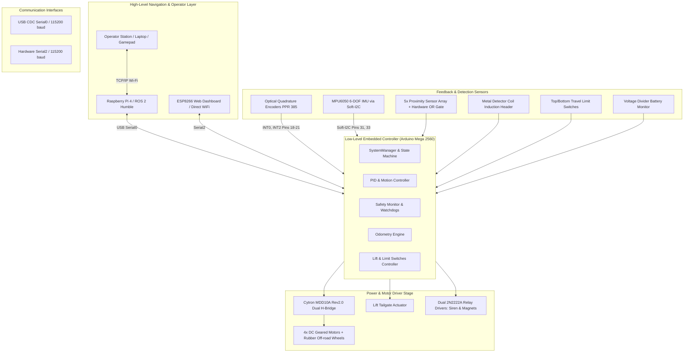
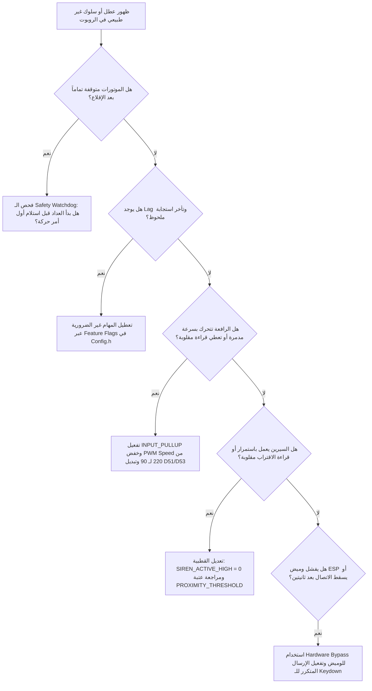
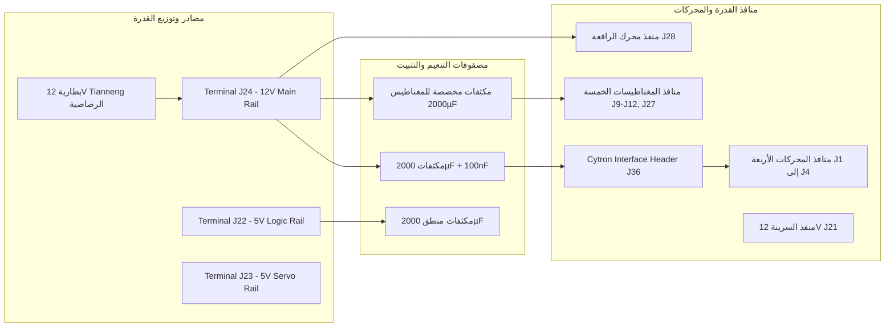
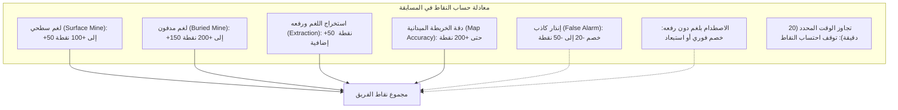
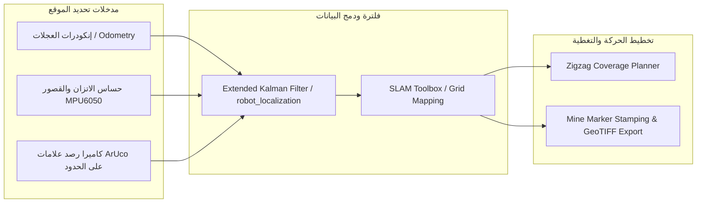

# Minesweeper Competitions Overview & Master Technical Report

## تقرير شامل عن تجربة ومنظومة روبوت كشف وإزالة الألغام (Minesweeper Robot)

**فريق أسيوط للروبوتات (Assiut Robotics Team) — كلية الهندسة، جامعة أسيوط**  
**إشراف:** م. سيد خضر  
**مجال العمل:** التحكم، البرمجيات المدمجة (Firmware)، الدوائر الإلكترونية (PCB & Power)، وتكامل أنظمة الذكاء الاصطناعي وROS 2  

---

> [!NOTE]
> هذا التقرير يمثل توثيقاً هندسياً شاملاً ومرجعاً تشغيلياً لتجربة تطوير ومراجعة وتصحيح واختبار روبوت المسابقات الميدانية لكشف الألغام الأرضية. يجمع التقرير بين التجارب العملية الواقعية، وتحليل أسباب الأعطال الميدانية وحلولها الجذرية، والخرائط التفصيلية للتوصيلات الكهربائية (Pinout) وبنية البرمجيات، إلى جانب دراسة استراتيجية متعمقة لقواعد مسابقات الألغام العالمية، وحلول الفرق الرائدة، والمسار التطويري المستقبلي للروبوت.

---

## فهرس المحتويات

1. [المسؤوليات والأنظمة التي تم تطويرها ومراجعتها](#1-المسؤوليات-والأنظمة-التي-تم-تطويرها-ومراجعتها)
2. [سجل الأعطال الميدانية الواقعية والحلول الجذرية (12 مشكلة واقعية)](#2-سجل-الأعطال-الميدانية-الواقعية-والحلول-الجذرية)
3. [تحليل اللوحة الإلكترونية (PCB) والدوائر الكهربائية](#3-تحليل-اللوحة-الإلكترونية-pcb-والدوائر-الكهربائية)
4. [خطة التطوير الهندسي المستقبلية والنماذج الرياضية](#4-خطة-التطوير-الهندسي-المستقبلية-والنماذج-الرياضية)
5. [استراتيجيات مسابقات الـ Minesweeper والدروس المستفادة من الفرق العالمية](#5-استراتيجيات-مسابقات-الـ-minesweeper-والدروس-المستفادة-من-الفرق-العالمية)
6. [خريطة التوثيق والمصادر التقنية للمشروع](#6-خريطة-التوثيق-والمصادر-التقنية-للمشروع)
7. [بروتوكول التدشين (Commissioning Checklist) ووصايا استمرارية الفريق](#7-بروتوكول-التدشين-commissioning-checklist-ووصايا-استمرارية-الفريق)

---

## 1. المسؤوليات والأنظمة التي تم تطويرها ومراجعتها

كان التركيز الأساسي منصبّاً على منظومة التحكم منخفض المستوى (**Low-Level Control & Firmware**)، واستقرار التواصل التسلسلي بين طبقات التحكم المختلفة، ومراجعة وضبط كود الموتورات والإنكودرات (Encoders)، ومعالجة إشارات الحساسات وضمان سلامة الروبوت أثناء التشغيل.

يعتمد الروبوت على بنية هجينة تجمع بين معالج متقدم ومتحكم دقيق:

1. **معالج الحوسبة العليا (High-Level Computing):** حاسوب **Raspberry Pi 4** يعمل بنظام **ROS 2** (توزيعة Humble)، مسؤول عن الرؤية الحاسوبية (Computer Vision & EasyOCR)، تحديد الموقع (Localization & SLAM)، وتخطيط المسارات التغطوية (Coverage Planning).
2. **المتحكم الدقيق منخفض المستوى (Low-Level Microcontroller):** لوحة **Arduino Mega 2560** مسؤولة عن التنفيذ اللحظي المباشر لأوامر الحركة عبر إشارات PWM، وحساب سرعات العجلات بدقة من خلال مقاطعات الإنكودر (Encoder Interrupts)، وتنفيذ خوارزمية التحكم المغلق (PID Loop)، وإدارة حساسات التصادم والأمان والمحركات المساعدة.



### أولاً: بنية النظام وثنائية التحكم (Dual Interface Architecture)

البيانات تتدفق بين المكونات بالصيغة التالية:
$$\text{ROS 2 / Navigation} \xrightarrow{\text{Serial Packet}} \text{Arduino Mega} \xrightarrow{\text{PWM / DIR}} \text{Cytron MDD10A} \xrightarrow{\text{Power}} \text{DC Motors}$$
وفي الاتجاه العكسي، يجمع الـ Arduino بيانات الـ Encoders والحساسات وحالة البطارية ويرسلها كـ Telemetry Messages إلى الـ Raspberry Pi لتحديث شجرة التحويلات (TF) وقرارات الملاحة.

ولضمان القدرة على عزل واختبار الأعطال الميدانية دون الحاجة لتشغيل كامل بيئة ROS 2، تم تزويد النظام بـ **ESP8266 WiFi Module** كواجهة تحكم واختبار بديلة ومستقلة:

- متصل بالـ Arduino Mega عبر منفذ العتاد `Serial2` (الأطراف D16/D17) بسرعة **115200 baud**.
- يوفر خادم ويب محلي (Web Dashboard) مدمج يعمل بتقنية WebSockets / HTTP.
- يتيح التحكم اليدوي المباشر عبر (WASD / Touch Joystick / Gamepad)، مع شاشة مراقبة لحظية لجهد البطارية، وحالة المفاتيح الحدية للرافعة، وقراءات حساسات المعادن والاقتراب، وإطلاق السيرين يدوياً.

### ثانياً: تفاصيل خوارزمية التحكم في الموتورات والـ PID

تم تصميم كود التحكم في الحركة بالاعتماد على حلقة تغذية راجعة مغلقة (Closed-Loop Feedback) باستخدام إنكودرات تربيعية:

- **متحكم المحركات (Motor Driver):** لوحة **Cytron MDD10A Rev2.0** تدعم تياراً مستمراً حتى 10A وتيار ذروة 30A لكل قناة، وتعمل بإشارات PWM وDirection مستقلة.
- **الإنكودرات (Encoders):** دقة النبضات المحسوبة هي **385 نبضة لكل دورة (PPR = 385)** بعد احتساب نسبة تخفيض صندوق التروس (Gear Ratio).
- **متحكم السرعة (Velocity PID Controller):** يقارن السرعة الخطية والزاوية المطلوبة بالسرعة الفعلية المقاسة على مستوى كل عجلة، ويعدل قيمة الـ PWM للحد من الخطأ ومنع الانحراف أثناء السير في خط مستقيم.
- **تغذية للأمام (Feed-Forward Term):** أضيف معامل $K_{ff} = 0.5$ للتغلب على القصور الذاتي والاستجابة الفورية مع بدء الحركة قبل تراكم خطأ التكامل.

معاملات الـ PID المعتمدة في ملف `Config.h`:

| المعامل الرياضي | العجلة اليمين (Right Wheel) | العجلة الشمال (Left Wheel) | الوظيفة الهندسية |
| :--- | :---: | :---: | :--- |
| **$K_p$ (Proportional)** | 11.5 | 12.8 | الاستجابة المباشرة لفرق السرعة الآني |
| **$K_i$ (Integral)** | 7.5 | 8.3 | القضاء التام على خطأ الحالة المستقرة (Steady-State Error) |
| **$K_d$ (Derivative)** | 0.1 | 0.1 | تخميد التذبذبات ومنع الـ Overshoot |
| **$K_{ff}$ (Feed-Forward)** | 0.5 | 0.5 | تعويض العزم المطلوب مبدئياً بحسب السرعة المستهدفة |

المعايير الميكانيكية والتشغيلية المعتمدة في `Config.h`:

- قطر العجلة الفعلي (Wheel Diameter): **65 mm** ($r = 0.0325\text{ m}$)
- المسافة العرضية بين العجلتين (Wheel Base): **150 mm** ($L = 0.15\text{ m}$)
- نطاق الخمول للموتور (PWM Deadband): **20** (أقل قيمة PWM تضمن بدء دوران المحرك دون احتراق الملفات)
- أقصى سرعة زاوية للعجلة (Max Velocity): **10 rad/s** (~0.325 m/s سرعة خطية)
- أقصى تسارع مسموح به (Max Acceleration): **15 rad/s²** لتفادي الصدمات الميكانيكية وتفويت نبضات التروس

### ثالثاً: التقسيم المعياري للـ Firmware (Modular Architecture)

تمت إعادة هيكلة وبرمجة الـ Firmware على الـ Arduino Mega ليتكون من وحدات برمجية مستقلة ومنفصلة (Object-Oriented Modules):

- `MotorDriver`: إدارة أطراف الـ PWM والاتجاه للتحكم في Cytron MDD10A.
- `Encoder`: قراءة نبضات الإنكودرات عبر أطراف المقاطعة الخارجية (External Interrupts) ومعالجة المشاكل الناتجة عن الـ Atomic Reads.
- `PIDController`: حسابات الـ PID والـ Anti-Windup وتوليد خرج الجهد المطلوب.
- `MotionController`: معالجة الكينماتيكا التفاضلية (Differential Drive Kinematics) وتحويل أوامر $v$ و $\omega$ إلى سرعات عجلات فردية.
- `SerialProtocol`: فك تشفير وتوثيق الرسائل التسلسلية الصادرة والواردة مع التأكد من سلامة الـ Frame.
- `IMU`: قراءة حساس MPU6050 عبر محاكاة برمجية لبروتوكول I²C (Software Bit-Banging).
- `LiftController`: إدارة حركة رافعة الألغام، وتأكيد حدود الحركة عبر المفاتيح الحدية مع الحماية الزمنية.
- `Sensors`: قراءة مصفوفة حساسات الاقتراب وحساس المعادن وقراءات الجهد.
- `Safety`: مراقبة المؤقتات الحارسة (Communication Watchdog) ومستوى شحن البطارية وحالات الإيقاف الطارئ (E-Stop).
- `SystemManager`: آلة الحالات التشغيلية (Finite State Machine) للتنقل بين حالات: `INIT`, `IDLE`, `ARMED`, `RUNNING`, `FAULT`.

---

## 2. سجل الأعطال الميدانية الواقعية والحلول الجذرية

> [!IMPORTANT]
> يوثق هذا القسم 12 عطلاً حقيقياً تم تشخيصها وحلها على أرض الواقع أثناء جلسات الفحص والاختبار الميداني للروبوت. تمثل هذه الحالات خلاصة دروس ثمينة تحمي أي مهندس قادم من إهدار ساعات في استكشاف أخطاء متكررة.



---

### المشكلة 1: بطء استجابة وتأخير الـ Firmware (RTOS Emulation Lag on Mega)

- **العَرَض:** لاحظنا تأخيراً كبيراً (Lag) في استجابة الروبوت لأوامر الحركة، وبطء في تحديث قراءات الحساسات عبر السيريال.
- **السبب الجذري:** كان الـ Firmware مبنياً بنمط يحاكي أنظمة التشغيل في الوقت الحقيقي (RTOS-like Multi-tasking) مع تعدد كبير في المهام الدورية (IMU fusion, Odometry math, Safety checks, EEPROM logging). معالج الـ Arduino Mega (ATmega2560 بتردد 16MHz وذاكرة RAM لا تتعدى 8KB) عجز عن ملاحقة كل هذه الحسابات الرياضية داخل حلقة الـ Loop مع مقاطعات الإنكودرات المتلاحقة.
- **الحل الجذري:** إضافة مفاتيح تجميع شرطية (Compile-time Feature Flags) في ملف `Config.h` تسمح بتعطيل أي وحدة ثانوية غير مستخدمة أثناء الاختبار:

```cpp
#define ENABLE_WATCHDOG        0
#define ENABLE_ODOMETRY        0
#define ENABLE_DIAGNOSTICS     0
#define ENABLE_SAFETY_MONITOR  0
#define ENABLE_IMU             0
#define ENABLE_LIFT            1
#define ENABLE_SENSORS         1
```

- **النتيجة والدرس:** انخفض زمن الدورة الواحدة للـ Loop من أكثر من 45ms إلى أقل من 2ms، مما وفر استجابة فورية لتحكم المحركات.

---

### المشكلة 2: تجمد الروبوت بعد الإقلاع مباشرة (Firmware Idle Deadlock)

- **العَرَض:** فور توصيل الطاقة وإقلاع الروبوت، ترفض المحركات الاستجابة لأي أمر، وتظهر حالة الروبوت في الـ Dashboard كـ `FAULT` أو "Cannot arm robot".
- **السبب الجذري:** في كود `Safety.cpp`، كان مؤقت الأمان ضد انقطاع الاتصال (Communication Timeout = 1.5s) يبدأ العد فور انتهاء دالة `setup()`، وقبل أن يفتح المشغل واجهة التحكم أو يرسل أول أمر حركة، فيدخل النظام فوراً في وضع الخطأ ويقفل مخارج الموتورات.
- **الحل الجذري:** تعديل منطق فحص الاتصال بحيث لا يبدأ احتساب زمن الـ Timeout إلا **بعد استقبال أول أمر حركة صالح بنجاح** (`first_command_received == true`).

---

### المشكلة 3: عطل رافعة الألغام (Gripper) وسرعتها التدميرية

- **العَرَض:** الرافعة الميكانيكية المخصصة لسحب الألغام السطحية لم تكن تتحرك نهائياً عند إرسال أمر الرفع أو الخفض. وعندما تحركت لاحقاً، اندفعت بسرعة فائقة واصطدمت بالهيكل وكسرت المفاتيح الحدية (Limit Switches).
- **السبب الجذري:**
  1. أطراف المفاتيح الحدية كانت مهيأة كـ `INPUT` عادي دون مقاومات شد، فكانت الأطراف عائمة (Floating) وتلتقط ضوضاء كهربائية جعلت المتحكم يظن أن الرافعة وصلت لنهاية مشوارها بالفعل.
  2. قيمة خرج الـ PWM المخصصة لموتور الرافعة كانت مضبوطة برمجياً على 220 (~86% من جهد البطارية)، وهو عزم هائل لآلية تروس دقيقة.
- **الحل الجذري:**
  1. تفعيل مقاومات الرفع الداخلية في الكود: `pinMode(pin, INPUT_PULLUP)`.
  2. خفض قيمة السرعة في `Config.h` من 220 إلى 90 (~35% Power):

```cpp
namespace LiftConfig {
    constexpr uint8_t LIFT_PWM_SPEED = 90;
}
```

---

### المشكلة 4: انعكاس أطراف المفاتيح الحدية (Limit Switch Inversion)

- **العَرَض:** عند الضغط يدوياً على المفتاح السفلي، تظهر لوحة التحكم أن الرافعة بلغت الحد العلوي (Top/Open) والعكس صحيح.
- **السبب الجذري:** خطأ في مطابقة التعيين البرمجي مع التوصيل الفعلي؛ حيث تم تعيين الطرف D51 كـ `LIMIT_SW_TOP` والطرف D53 كـ `LIMIT_SW_BOTTOM`، بينما الأسلاك الفيزيائية كانت معكوسة على لوحة الـ PCB.
- **الحل الجذري:** تبديل التعيين البرمجي في `Config.h` وتحديث وثيقة `Docs/Pinout.md`:
  - `D51` ← المفتاح السفلي (LIMIT_BOT).
  - `D53` ← المفتاح العلوي (LIMIT_TOP).

---

### المشكلة 5: تعارض أطراف الـ Hardware I²C مع إنكودرات الحركة (D20/D21 Conflict)

- **العَرَض:** تعذر قراءة حساس الاتجاه والاتزان MPU6050 عبر منفذ I²C العتادي للـ Mega بمجرد توصيل إنكودرات العجلات.
- **السبب الجذري:** مسارات النحاس على لوحة الـ PCB قامت بربط إشارات الإنكودر الأول (ENC1) بالأطراف D20 وD21 للاستفادة من المقاطعات العتادية. لكن هذين الطرفين على متحكم ATmega2560 هما نفس أطراف ناقل I²C العتادي (`SDA` / `SCL`)، مما تسبب في تصادم كهربائي بين نبضات الإنكودر وإشارات الـ Bus.
- **الحل الجذري:** بدلاً من تعديل اللوحة المطبوعة، تم تفعيل ناقل I²C برمجي (Software Bit-Banging) ونقل توصيل الحساس إلى الأطراف D31 (SDA) وD33 (SCL) عبر أسلاك توصيل خارجية (Flying Leads):

```cpp
#define USE_SOFT_I2C_FOR_IMU 1
#define SOFT_I2C_SDA_PIN    31
#define SOFT_I2C_SCL_PIN    33
```

---

### المشكلة 6: عمل سرينة الإنذار بشكل معكوس (Active-Low Inversion)

- **العَرَض:** بمجرد تشغيل الروبوت، تطلق سرينة الإنذار (12V Siren) صوتاً مستمراً لا يتوقف، وتنطفئ فقط عند اكتشاف لغم!
- **السبب الجذري:** الدائرة الإلكترونية المشغلة للريلاي على الـ PCB تستخدم ترانزستور NPN (2N2222A) مع ملف الريلاي بحيث يفتح الريلاي عند الإشارة المنخفضة تبعاً لتوصيل الـ Pull-up الداخلي، بينما الكود كان يعرّف الطرف كـ `Active High` (`SIREN_ACTIVE_HIGH = 1`).
- **الحل الجذري:** عكس الحالة البرمجية في `Config.h`:

```cpp
#define SIREN_ACTIVE_HIGH 0
```

---

### المشكلة 7: قراءات شاذة ومعكوسة لمصفوفة حساسات الاقتراب (Proximity Array)

- **العَرَض:** حساس الاقتراب البصري يقرأ القيمة العظمى (1023) في غياب أي جسم أمامه، ويهبط إلى 23 عند وضع لغم أمامه مباشرة، مما تسبب في إرباك خوارزمية تمييز نوع اللغم.
- **السبب الجذري:** إشارة الخرج القادمة من الحساس تمر عبر بوابة جمع منطقية (OR Gate) ومقاومات انحياز تجعل الخرج الافتراضي مرتفعاً، مع عدم ضبط عتبة المقارنة (Threshold).
- **الحل الجذري:** ضبط منطق العتبة برمجياً لإعادة معايرة القراءة وإضافة مفتاح لعزل حساس المعادن مؤقتاً أثناء تصحيح اللوحة:

```cpp
#define ENABLE_PROXIMITY     1
#define PROXIMITY_THRESHOLD  500
#define ENABLE_METAL_DETECTOR 0 // تم تعطيله مؤقتاً أثناء فحص الـ PCB
```

---

### المشكلة 8: فشل برمجة شريحة ESP8266 عبر منفذ السيريال (Flashing Failure)

- **العَرَض:** فشل حرق الكود الجديد على شريحة الـ ESP8266 عند محاولة تمرير البيانات عبر الـ Arduino Mega (Serial Passthrough).
- **السبب الجذري:** كود الـ Passthrough على الـ Mega لم يتمكن من ملاحقة معدلات نقل البيانات العالية (High-Speed Baud Rates > 115200) أثناء عملية الـ Flashing، مما أدى إلى فقدان بايتات وحدوث Bootloader Timeout.
- **الحل الجذري:** استخدام ممر عتادي مباشر (Hardware Bypass) عبر لوحة Arduino Uno بديلة:
  1. توصيل طرف `RESET` في الـ Uno بالأرضي `GND` لتعطيل معالج الـ Uno بالكامل واستخدام دارة USB-to-UART المدمجة به فقط.
  2. توصيل `TX` الـ Uno بـ `TX` الـ ESP8266، و`RX` الـ Uno بـ `RX` الـ ESP8266.
  3. حرق كود الـ WiFi Dashboard مباشرة وبسرعة فائقة.

---

### المشكلة 9: انقطاع حركة الروبوت كل ثانيتين في واجهة الويب (Watchdog Stoppage)

- **العَرَض:** عند قيادة الروبوت من متصفح الويب بالضغط على مفاتيح الأسهم (WASD)، يتحرك الروبوت لمدة ثانيتين فقط ثم يتوقف فجأة على الرغم من استمرار المشغل في الضغط على المفتاح.
- **السبب الجذري:** حدث الـ JavaScript `keydown` في المتصفح كان يرسل طلباً واحداً فقط لحظة الضغط الأولى. بعد مرور مهلة الأمان (Watchdog Timeout = 1.5s) دون وصول أمر جديد، يقوم الـ Mega بإيقاف الموتورات تلقائياً لمنع هروب الروبوت (Runaway Protection).
- **الحل الجذري:** تعديل كود واجهة الـ Frontend لإطلاق حلقة مؤقتة (`setInterval` بمعدل 10Hz / كل 100ms) تعيد إرسال أمر الحركة بصفة متكررة ومستمرة طالما ظل المفتاح مضغوطاً، وتلغيه فور حدوث حدث `keyup`.

---

### المشكلة 10: شلل إقلاع ESP8266 بسبب دائرة مقسم جهد البطارية (Boot Pin Conflict)

- **العَرَض:** عند تركيب دائرة مقسم الجهد (Voltage Divider) لقياس جهد البطارية وإرساله للمشغل، توقفت شريحة الـ ESP8266 عن العمل والإقلاع نهائياً.
- **السبب الجذري:** تم وضع مقاومة 10kΩ المتصلة بالأرضي قريباً جداً من أطراف التحكم في الإقلاع (`EN` أو `GPIO0` أو `RST`) على الشريحة، مما تسبب في سحب الطرف لجهد منخفض أثناء الـ Bootloader Phase، فمنع المعالج من بدء التشغيل.
- **الحل الجذري:** عزل مسار مقسم الجهد ميكانيكياً وكهربائياً وتوصيله حصرياً بطرف الدخل التناظري `A0` فقط.
  - بطارية الروبوت: Tianneng TNE12-25 Graphene (12V الرصاصية، أقصى شحن يصل لـ 14.8V).
  - نسبة مقسم الجهد: استخدام مقاومات تقسم الجهد بمعامل 3.3 لتحويل أقصى جهد (14.8V) إلى ما لا يتجاوز 4.48V لحماية منفذ القياس.

---

### المشكلة 11: ارتفاع حرارة المغناطيس الكهربائي وتلف العزل (Electromagnet Overheating)

- **العَرَض:** ارتفاع درجة حرارة المغناطيس المخصص لالتقاط الألغام السطحية لمستويات خطيرة كادت تصهر العزل البلاستيكي وتفرغ شحنة البطارية بسرعة.
- **السبب الجذري:** تشغيل ملف المغناطيس بجهد 12V مستمر (100% Duty Cycle) لفترات طويلة دون وجود مهلة إطفاء تلقائي.
- **الحل الجذري:**
  1. إضافة نظام مؤقت زمني تلقائي (Auto-Off Safety Timer) في الـ Firmware يقوم بفصل التغذية عن المغناطيس بعد مرور 8 ثوانٍ من التقاط اللغم ورفعه إلى صندوق التخزين.
  2. توفير خيار التحكم اليدوي المشروط في واجهة الـ Dashboard لضمان عدم تفعيل المغناطيس إلا عند الحاجة الفعلية.

---

### المشكلة 12: بطء الحركة وعدم استجابة الروبوت عبر ROS 2 (Serial Interface Bottleneck)

- **العَرَض:** أثناء تشغيل الروبوت من الـ Raspberry Pi تحت بيئة ROS 2، كانت حركة الروبوت بطيئة للغاية ومتقطعة، بينما حساسات الاقتراب والسيرين كانت تعمل بكفاءة تامة.
- **السبب الجذري:** المشكلة لم تكن في عتاد الروبوت أو محركاته، بل في طريقة عمل عقدة الـ ROS 2 Serial Interface؛ حيث كانت تقوم بفتح وإغلاق منفذ السيريال مع كل رسالة، وتنتظر استقبال رسالة تأكيد (Blocking Serial Read) متزامنة لكل أمر سرعة قبل إرسال الأمر التالي.
- **الحل الجذري:** إعادة كتابة طبقة الـ Communication في ROS 2 لتكون غير متزامنة (Asynchronous Non-blocking I/O) وتعتمد على تدفق مستمر للرسائل بتردد ثابت (20Hz) مع قراءة السيريال في خيط منفصل (Separate Background Thread).

---

## 3. تحليل اللوحة الإلكترونية (PCB) والدوائر الكهربائية

تعتمد المنظومة الإلكترونية للروبوت على مجموعة لوحات مخصصة تم تصميمها وفقاً للمخطط الهندسي `mine_sch.pdf`:



### 3.1 جدول أطراف التوصيل العتادية الحالية (Synchronized Pinout Map)

| الطرف (Mega Pin) | اسم الإشارة (Net) | الاتجاه | الوظيفة الهندسية | نوع التوصيل الفيزيائي |
| :---: | :---: | :---: | :--- | :--- |
| **D18** | `B2` | Input | القناة B للإنكودر الأيمن | كابل الضفيرة الرئيسية |
| **D19** | `A2` | Input | القناة A للإنكودر الأيمن (مقاطعة INT2) | كابل الضفيرة الرئيسية |
| **D20** | `B1` | Input | القناة B للإنكودر الأيسر | كابل الضفيرة الرئيسية |
| **D21** | `A1` | Input | القناة A للإنكودر الأيسر (مقاطعة INT0) | كابل الضفيرة الرئيسية |
| **D4** | `SERVO` | Output | سيرفو توجيه الكاميرا (Timer 3 PWM 50Hz) | سلك مخصص مباشر |
| **D7** | `LIFT_PWM` | Output | تحكم سرعة محرك الرافعة (Timer 4 OC4B) | مشغل الرافعة |
| **D49** | `LIFT_DIR` | Output | تحديد اتجاه صعود/هبوط الرافعة | مشغل الرافعة |
| **D51** | `LIMIT_BOT` | Input | المفتاح الحدي السفلي للرافعة (Active LOW) | COM إلى GND، NO إلى Pin |
| **D53** | `LIMIT_TOP` | Input | المفتاح الحدي العلوي للرافعة (Active LOW) | COM إلى GND، NO إلى Pin |
| **D43** | `US_TRIG` | Output | نبضة إطلاق حساس الموجات فوق الصوتية | ضفيرة الحساس |
| **D45** | `US_ECHO` | Input | زمن صدى حساس الموجات فوق الصوتية | ضفيرة الحساس |
| **D23** | `PROX1` | Input | حساس الاقتراب الأول | ضفيرة الحساسات |
| **D25** | `PROX2` | Input | حساس الاقتراب الثاني | ضفيرة الحساسات |
| **D27** | `PROX3` | Input | حساس الاقتراب الثالث | ضفيرة الحساسات |
| **D29** | `PROX4` | Input | حساس الاقتراب الرابع | ضفيرة الحساسات |
| **D31** | `PROX5 / SDA` | In/Out | حساس الاقتراب الخامس / خط بيانات Soft-I2C | Flying Lead للحساس |
| **D33** | `MD_PIN / SCL` | In/Out | دخل حساس المعادن / خط ساعة Soft-I2C | Flying Lead للحساس |
| **D37** | `SIREN` | Output | ريلاي سرينة الإنذار 12V (Active LOW برمجياً) | موديول الريلاي |
| **D38** | `MAGNET` | Output | ريلاي تشغيل المغناطيس الكهربائي | موديول الريلاي |
| **D40** | `DIR2` | Output | اتجاه دوران المحرك الأيسر | Cytron MDD10A (J36) |
| **D42** | `DIR1` | Output | اتجاه دوران المحرك الأيمن | Cytron MDD10A (J36) |
| **D44** | `PWM1` | Output | سرعة المحرك الأيمن (Timer 5 OC5C) | Cytron MDD10A (J36) |
| **D46** | `PWM2` | Output | سرعة المحرك الأيسر (Timer 5 OC5A) | Cytron MDD10A (J36) |
| **D13** | `LED` | Output | مؤشر الحالة المدمج على اللوحة | Onboard LED |
| **A0** | `BAT_SENSE` | Input | دخل مقسم الجهد التناظري لمراقبة البطارية | مقسم جهد 3.3:1 |

### 3.2 توزيع قنوات ومنافذ القدرة والمؤشرات الضوئية (Status LEDs)

- **المحركات الرئيسية:** 4 محركات DC عالية العزم مزودة بصناديق تروس تدير العجلات الأربع بنظام دفع رباعي وتوجيه تفاضلي (Skid-Steering).
- **تنبيه طباعة اللوحة (Silkscreen Interlock):** كتب على طباعة اللوحة النحاسية عبارة صريحة:
  > *"TO TURN THE MOTOR YOU MUST TURN ON THE MAGNETS"*  
  وهي دائرة أمان تمنع دوران المحركات دون تفعيل مسار القدرة للمغناطيسات لضمان عدم دوران الآلية دون حمل.
- **دوائر الترانزستور والريلاي:**
  - الريلاي **K1:** مخصص لمصفوفة المغناطيسات (`MAG1` إلى `MAG5`)، يقوده ترانزستور `2N2222A` ومحمي بديود تفريغ عكسي `1N4007` لمنع تيارات الحث الذاتي (Back-EMF).
  - الريلاي **K2:** مخصص لسرينة الإنذار `J21`، يقوده ترانزستور مستقل بديود حماية.

---

## 4. خطة التطوير الهندسي المستقبلية والنماذج الرياضية

### أولاً: النمذجة الرياضية لكينماتيكا الحركة وحسابات الـ Odometry

يعتمد الروبوت على نموذج الحركة التفاضلية (Differential Drive Kinematics):
إذا كانت $v$ هي السرعة الخطية لمركز الروبوت (Linear Velocity)، و $\omega$ هي السرعة الدورانية حول المحور الرأسي (Angular Velocity)، فإن السرعة الخطية المستهدفة لكل عجلة تُحسب كالتالي:
$$v_R = v + \frac{\omega \cdot L}{2}$$
$$v_L = v - \frac{\omega \cdot L}{2}$$
حيث $L = 0.15\text{ m}$ (المسافة العرضية بين العجلتين).

ويتم تحويل السرعة الخطية إلى سرعة دورانية بالـ $\text{rad/s}$ عبر قسمتها على نصف قطر العجلة ($r = 0.0325\text{ m}$):
$$\omega_R = \frac{v_R}{r}, \quad \omega_L = \frac{v_L}{r}$$

وحساب السرعة المقاسة لحظياً من نبضات الإنكودر ($\Delta \text{Ticks}$) خلال فترة زمنية ($\Delta t$):
$$v_{\text{measured}} = \frac{\Delta \text{Ticks} \cdot 2\pi \cdot r}{\text{PPR} \cdot \Delta t}$$
حيث $\text{PPR} = 385$.

معادلة الـ PID المزودة بخاصية الـ Feed-Forward لمنع تأخر استجابة المحرك:
$$u(t) = K_p \cdot e(t) + K_i \int_0^t e(\tau) d\tau + K_d \frac{de(t)}{dt} + K_{ff} \cdot v_{\text{target}}$$

### ثانياً: دراسة جدوى الانتقال إلى معالج STM32 (Blue Pill / Black Pill)

يوصى بدراسة استبدال لوحة Arduino Mega 2560 بمتحكم دقيق من عائلة **ARM Cortex-M3/M4** مثل **STM32F103C8T6** أو **STM32F401/411**:

| وجه المقارنة | Arduino Mega 2560 (الحالي) | STM32F103C8T6 (Blue Pill) | STM32F401/411 (Black Pill) |
| :--- | :---: | :---: | :---: |
| **المعالج المعماري** | 8-bit AVR RISC | 32-bit ARM Cortex-M3 | 32-bit ARM Cortex-M4 (مع FPU عتادي) |
| **تردد الساعة (Clock Speed)** | 16 MHz | 72 MHz (4.5 أضعاف) | 84 - 100 MHz (6 أضعاف) |
| **ذاكرة الرام (SRAM)** | 8 KB | 20 KB | 64 - 128 KB |
| **قراءة الإنكودرات (Encoders)** | مقاطعات برمجية تثقل المعالج | **Hardware Quadrature Timers** (بدون استهلاك CPU) | **Hardware Quadrature Timers** (مستقلة تماماً) |
| **مستوى الجهد المنطقي (Logic)** | 5V (يتطلب مقسمات جهد مع RPi/ESP) | 3.3V (متوافق أصلياً مع RPi و ESP) | 3.3V (متوافق أصلياً) |
| **منافذ DMA** | غير مدعوم | مدعوم للسيريال وقراءات الحساسات | نقل بيانات فائق السرعة عبر DMA |

**خارطة نقل الأطراف المقترحة (STM32 Pin Migration):**

- إنكودر اليمين: `TIM2` (أطراف `PA0`, `PA1` كـ Encoder Mode).
- إنكودر الشمال: `TIM3` (أطراف `PA6`, `PA7` كـ Encoder Mode).
- مخارج Cytron PWM: `TIM4` (أطراف `PB6`, `PB7` بتردد 20kHz لمنع صفير المحركات المسموع).
- اتصال ROS 2 السريع: `USART1` بسرعة 460800 baud عبر قنوات DMA.

---

## 5. استراتيجيات مسابقات الـ Minesweeper والدروس المستفادة من الفرق العالمية

> [!TIP]
> مسابقات الروبوتات الميدانية لكشف وإزالة الألغام (مثل **Minesweeper International Competition** و**Minesweeper Egypt**) لا تعتمد فقط على وجود روبوت يتحرك، بل تُحسم من خلال استراتيجيات دقيقة لتحصيل النقاط وتفادي العقوبات الجزائية الصارمة.



### 5.1 تحليل قواعد المسابقة ونظام التسجيل (Scoring & Penalty Optimization)

1. **الألغام السطحية مقابل المدفونة:**
   - الألغام المدفونة تعطي وزناً تصاعدياً للنقاط (غالباً ضعف نقاط السطحية)، لكن اكتشافها يتطلب معايرة فائقة لحساس المعادن.
   - الخطأ الكارثي للفرق المبتدئة هو تكرار **الإنذارات الكاذبة (False Positives)**؛ تسجيل جسم معدني وهمي يخصم نقاطاً قد تبتلع كامل النقاط المكتسبة.
2. **شروط الخريطة الجغرافية المعتمدة (Geo-referenced Mine Map):**
   - لجنة التحكيم تطلب خريطة نهائية بصيغة رسمية توضح إحداثيات كل لغم بنسبة خطأ مسموح بها لا تتجاوز $\pm 15\text{ cm}$ إلى $\pm 20\text{ cm}$.
   - الخطأ الشائع: الاعتماد على إنكودرات العجلات وحدها لتحديد إحداثيات الألغام في تربة رملية يؤدي لتراكم خطأ الإزاحة (Dead Reckoning Drift) ليصبح موقع اللغم على الخريطة بعيداً بنصف متر، فتعتبره اللجنة لغماً لم يتم اكتشافه وتخصم نقاط الخريطة!

---

### 5.2 هندسة ملفات وحساسات كشف الألغام (Advanced Detection Arrays)

#### أ. مقارنة تقنيات الكشف الكهرومغناطيسي

- **تذبذب التردد النابض (BFO - Beat Frequency Oscillator):** تقنية قديمة ورخيصة لكنها شديدة التأثر بدرجة الحرارة والضوضاء وغير مستقرة في الميدان.
- **الحث النبضي (PI - Pulse Induction):** الخيار الذهبي للمسابقات؛ يتميز بقدرته الفائقة على اختراق التربة المعدنية والصحراوية الحاوية على خامات الحديد والأملاح دون إطلاق إنذارات كاذبة، ولا يتأثر بتغير ارتفاع الحساس عن الأرض مثل باقي التقنيات.
- **التردد بالغ الانخفاض (VLF - Very Low Frequency):** ممتاز في التمييز بين أنواع المعادن (Metal Discrimination)، لكنه يتطلب موازنة دقيقة للأرضي (Ground Balance).

#### ب. مصفوفات الملفات المتداخلة (Overlapping Coil Arrays)

- الفرق الفائزة لا تعتمد على ملف كشف وحيد في منتصف الروبوت؛ لأن الملف الوحيد يترك مناطق عمياء (Blind Spots) على الجانبين ويجبر الروبوت على السير بمسارات شديدة التقارب.
- **التصميم الموصى به:** مصفوفة من 3 ملفات بيضاوية أو دائرية متداخلة بنسبة 25% لتغطية كامل عرض الروبوت (Sweeping Width = 40-50 cm).

```
   [ Coil 1 (Left) ]       [ Coil 3 (Right) ]
         \               /
          [ Coil 2 (Center) ]
```

#### ج. إلغاء الضوضاء التفاضلي (Differential Noise Cancellation)

تطلق محركات الدفع وتيارات الـ PWM المنبعثة من Cytron مجالات كهرومغناطيسية تتداخل مباشرة مع الإشارات الضعيفة المقاسة من ملف كشف الألغام.

- **الحل الهندسي المتبع لدى الفرق المحترفة:**
  1. وضع ملف تعويض وهمي (Dummy Coil) بالقرب من الشاسيه لقياس ضوضاء المحركات وطرحها تفاضلياً (Differential Subtraction) عبر مضخم عملياتي (Op-Amp) من قراءة ملف الكشف الرئيسي.
  2. مزامنة نبضة فحص المعدن برمجياً مع لحظات الـ PWM Inactive State للمحركات.

---

### 5.3 استراتيجيات الميكانيكا والحركة في التربة الصحراوية الوعرة (Mobility & Dynamics)

1. **معضلة الانغراس والتجريف (Sinkage & Bulldozing Effect):**
   - الروبوتات ذات العجلات الرفيعة تغوص في رمال الصحراء الناعمة. العجلات المستخدمة الحالية (قطر 22 cm وعرض 10 cm من المطاط المسنن) ممتازة، ولكن يجب تقليل وزن الروبوت الكلي (Lightweighting) باستخدام أذرع ألومنيوم مفرغة وشاسيه أكريليك/كاربون فايبر.
2. **نظام التعليق الصخري (Rocker-Bogie vs Skid-Steering):**
   - في المنحدرات والحفر، يفقد التوجيه الانزلاقي (Skid-Steering) تلامس إحدى العجلات بالأرض، مما يؤدي لانحراف زاوي مفاجئ وتلف قراءة الإنكودر.
   - إضافة مفصل تعليق ميكانيكي وسطي (Passive Rocker Pivot) يسمح لجميع العجلات الأربع بملامسة تضاريس التربة باستمرار.
3. **ديناميكا سحب الألغام وانتقال مركز الثقل (Center of Gravity Shift):**
   - عند إنزال الرافعة والتقاط لغم سطحي وزنه 150-300 جرام، يزاح مركز الثقل للأمام، مما قد يرفع العجلات الخلفية عن الأرض ويفقدها الجر.
   - يجب توزيع البطاريات الثقيلة في أقصى الخلف لتكون بمثابة ثقل موازن (Counter-weight).

---

### 5.4 الملاحة وتحديد الموقع الميداني بدون نظام تحديد المواقع (GPS-Denied Localization)

في مسابقات الألغام المغلقة أو المفتوحة، لا تكون دقة الـ GPS العادي ($\pm 3\text{ m}$) كافية إطلاقاً. الحلول الفعالة والمطبقة عالمياً:

1. **دمج الحساسات الممتد (Robot Localization via EKF):**
   - دمج سرعات العجلات من الـ Encoders مع التسارع والسرعة الزاوية من MPU6050 عبر مرشح كالمان الممتد (Extended Kalman Filter - EKF) لتصحيح الانزلاق.
2. **العلامات البصرية المرجعية (ArUco / AprilTags on Arena Boundary):**
   - وضع 4 لوحات مرجعية مزودة بكود ArUco على زوايا ملعب المسابقة الأربع على ارتفاع محدد.
   - كاميرا الروبوت ترصد العلامات المرجعية وتحسب موقع الروبوت المطلق بدقة السنتيمتر عبر خوارزميات `solvePnP` في OpenCV، مما يلغي تماماً أي تراكم للأخطاء عبر الزمن (Drift-Free Global Localization).
3. **تخطيط المسار التغطوي بنمط المشط (Zigzag / Lawnmower Coverage Planning):**
   - تغطية حقل الألغام عبر خوارزمية Zigzag المضمنة في حزمة `rover_planning`.
   - ضبط المسافة البينية بين خطوط المسح لتكون أقل من عرض مصفوفة الكشف بنسبة 15% لضمان عدم ترك أي شريط غير ممسوح في الملعب.



---

### 5.5 العزل الكهرومغناطيسي وحماية الدوائر الحساسة (EMI Mitigation & Grounding)

- **الأرضي النجمي الموحد (Star Grounding):** منع رجوع تيارات المحركات العالية (حتى 20A) عبر مسارات الأرضي الخاصة بحساسات الـ I²C ومتحكم الـ Mega؛ حيث يجب تجميع أرضي القدرة وأرضي الإشارة في نقطة فيزيائية واحدة عند قطب البطارية السالب.
- **الحلقات الفيريتية (Ferrite Beads):** لف كابلات محركات الدفع حول حلقات فيريتية لقمع الإشعاعات الترددية الناتجة عن تبديل الـ MOSFETs في Cytron.
- **العزل البصري (Optocoupler Isolation):** عزل خطوط التحكم PWM و Direction بين الـ Mega ومتحكم Cytron بمحولات عزل ضوئي.

---

## 6. خريطة التوثيق والمصادر التقنية للمشروع

لضمان سهولة وصول أعضاء الفريق لكافة تفاصيل المنظومة، تم تنظيم وهيكلة الملفات المرجعية في المستودع كالتالي:

| الوثيقة المرجعية | المسار في المستودع | المحتوى الهندسي المغطى | الحالة |
| :--- | :--- | :--- | :---: |
| **دليل الأطراف والتوصيل** | `Minesweeper2026/Arduino/MotorController/Docs/Pinout.md` | جداول الربط التفصيلية ومسارات الأطراف | مكتمل ومحدث |
| **مخطط البنية والطبقات** | `Minesweeper2026/Arduino/MotorController/Docs/Architecture.md` | هيكل الـ Firmware وآلة الحالات التشغيلية | مكتمل ومحدث |
| **بروتوكول التواصل** | `Minesweeper2026/Arduino/MotorController/Docs/Communication.md` | حزم السيريال وأوامر الـ Telemetry والـ ASCII | مكتمل ومحدث |
| **التحكم الحركي والـ PID** | `Minesweeper2026/Arduino/MotorController/Docs/MotionControl.md` | معادلات السرعة وحسابات الـ Odometry وتجاوز الـ Deadband | مكتمل ومحدث |
| **دليل الأمان والمراقبة** | `Minesweeper2026/Arduino/MotorController/Docs/Safety.md` | آليات الـ Watchdog وحالات التوقف الطارئ وتفريغ البطارية | مكتمل ومحدث |
| **تقرير الدوائر والـ PCB** | `Minesweeper2026/Files/Report/report.md` | تحليل `mine_sch.pdf` واللوحات الثلاث ومصفوفات القدرة | مكتمل باللغة الإنجليزية |
| **حزمة ROS 2 الكاملة** | `rover_ws/README.md` | تشغيل المحاكاة، خوارزمية Zigzag، الرؤية والتوطين | مكتمل وشامل |
| **واجهة التحكم والـ GUI** | `Minesweeper2026/GUI/README.md` | تطبيق سطح المكتب PySide6 وتوصيل لوحة القيادة | مكتمل وموثق |
| **دليل التوصيلات السلكية** | `Minesweeper2026/Arduino/MotorController/Docs/WiringManual.md` | مواصفات أقطار الأسلاك، وتوزيع الـ Terminals والموصلات | مكتمل |

---

## 7. بروتوكول التدشين (Commissioning Checklist) ووصايا استمرارية الفريق

### 7.1 قائمة الفحص الميداني قبل بدء أي اختبار أو مسابقة (Pre-Flight Checklist)

```markdown
- [ ] 1. فحص جهد البطارية: الجهد بدون حمل > 12.6V (تجنب التشغيل إذا كان أقل من 11.8V).
- [ ] 2. فحص ميكانيكي: التأكد من إحكام مسامير ربط العجلات ومحاور التروس ومثبتات الرافعة.
- [ ] 3. فحص حركة المحركات اليدوية: رفع الروبوت على منصة فحص (Test Bench) وتشغيل المحركات للتأكد من اتجاه الدوران (الأمام للأمام والخلف للخلف).
- [ ] 4. فحص نبضات الإنكودر: إدارة كل عجلة دورة كاملة يدوياً والتأكد من قراءة ~385 نبضة بالاتجاه الموجب في لوحة المراقبة.
- [ ] 5. فحص أمان الاتصال: فصل كابل السيريال أثناء دوران المحركات والتأكد من توقفها تماماً خلال 1.5 ثانية (Watchdog Verification).
- [ ] 6. فحص المفاتيح الحدية للرافعة: الضغط يدوياً على المفتاح السفلي والعلوي والتأكد من انطفاء أمر المحرك فورياً.
- [ ] 7. فحص مصفوفة الاقتراب: تمرير عينة لغم للتأكد من إضاءة الليدات الزرقاء وسماع صوت السيرين التحذيري.
- [ ] 8. فحص قفل وتثبيت الأسلاك الطائرة (Flying Leads): التأكد من عدم ملامسة أسلاك الـ Soft-I2C لخطوط القدرة العالية.
```

---

### 7.2 وصايا ذهبية لاستمرارية وتطور الفريق (Engineering Team Culture)

1. **التوثيق الفوري للأخطاء:**  
   المهندس المتميز ليس من لا يرتكب أخطاء، بل من لا يكرر خطأه مرتين ولا يسمح لزميله بالوقوع فيه. وثقوا كل تعديل، كل عطل، وكل رقم معايرة في الـ Repository.
2. **الاعتماد الصارم على Git و GitHub:**  
   يُحظر تماماً نقل الكود عبر الفلاشات أو رسائل الواتساب أو الاحتفاظ بنسخ "الكود_النهائي_شغال_2". كل تعديل يجب أن يمر بـ Git Branch و Pull Request واضح، لسهولة التراجع عن أي تعديل مسبب للأعطال.
3. **لا تختبر لأول مرة في ساحة المسابقة:**  
   كل نظام فرعي (Subsystem) يجب أن يخضع للاختبار المنفرد أولاً (Unit Testing)، ثم اختبار التكامل الثنائي (Integration Testing)، ثم اختبار المحاكاة الميدانية الكاملة في ظروف رملية مشابهة للسباق قبل موعد السفر بأسبوعين على الأقل.
4. **تكامل الهاردوير والسوفتوير:**  
   لا يمكن لمبرمج أن يكتب كود تحكم فعال دون فهم دقيق لمسارات الـ PCB ومواصفات المحركات، ولا يمكن لمهندس هاردوير أن يصمم لوحة دون إدراك لاحتياجات المقاطعات العتادية والتأريض السليم. التنسيق الدائم بين اللجان هو مفتاح الفوز.
5. **النجاح الحقيقي هو البدء من حيث انتهى السابقون:**  
   هدف هذا التوثيق هو أن يبدأ الجيل القادم من مهندسي تيم أسيوط من القمة التي وصل إليها هذا الروبوت، لتطوير روبوتات قادرة على حصد المراكز الأولى دولياً وتمثيل كليتنا وجامعتنا بالشكل الذي تستحقه دائماً.
