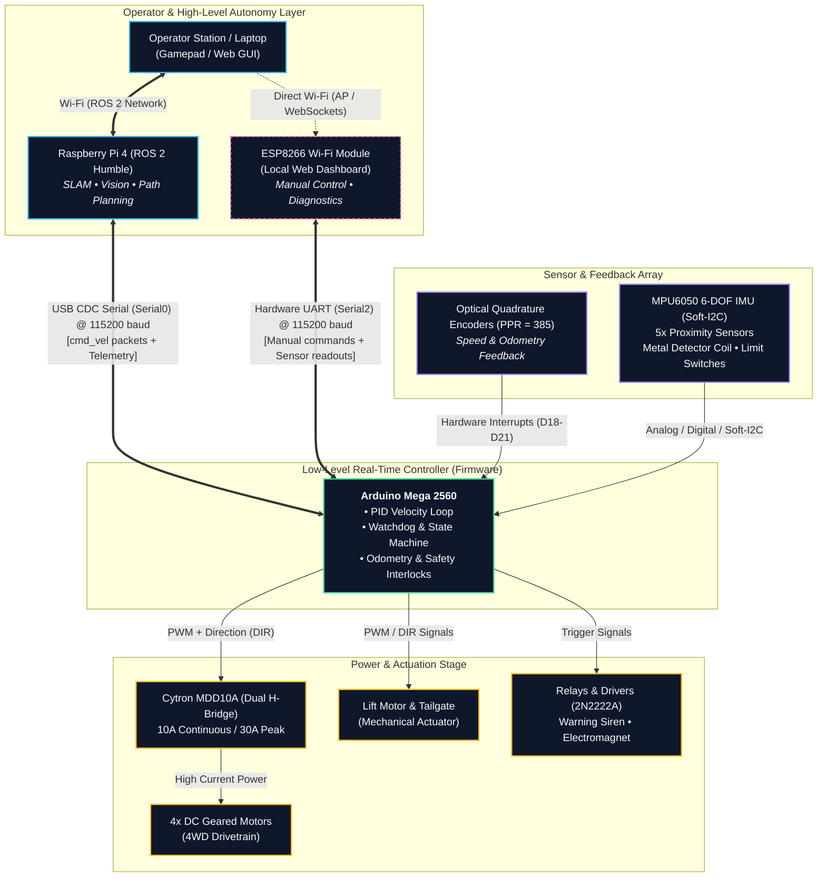

# Minesweeper Robot – Overview وتجربة الشغل على المشروع

## فريق Assiut Robotics – كلية الهندسة، جامعة أسيوط

**إشراف:** م. سيد خضر  
**مجالات الشغل:** Control، Firmware، مراجعة الـ PCB والتوصيلات، وربط الـ Arduino مع Raspberry Pi وROS 2.

---

## قبل ما نبدأ

التقرير ده معمول علشان يبقى مرجع عملي للفريق، مش مجرد كلام كبير عن إن كل حاجة اتنفذت وبقت perfect. الفكرة إننا نجمع اللي فهمناه عن الروبوت، والمشاكل اللي ظهرت أثناء مراجعة وتشغيل الأنظمة، والحاجات اللي محتاجة اختبار أو تأكيد، وبعدها نحط خطة واضحة للي جاي.

فيه فرق مهم بين 3 حاجات في التقرير:

- **مشكلة اتلاحظت أو اتناقشت أثناء الـ debugging:** محتاجة يتسجل معاها الاختبار أو الدليل اللي أكدها.
- **حل اتجرّب واتأكد منه:** نقدر نقول إنه حل للمشكلة بعد ما نعيد الاختبار ونوثّق النتيجة.
- **اقتراح تطوير:** فكرة مفيدة، لكنها مش معناها إنها اتنفذت بالفعل.

علشان كده، أي أرقام أو Pin assignments أو قيم موجودة هنا لازم تتراجع مع نسخة الكود والـ PCB اللي الفريق بيستخدمها فعلًا، خصوصًا لو حصلت تعديلات بعد آخر نسخة.

---

## 1. إحنا كنا شغالين على إيه؟

الجزء الأساسي اللي التقرير مركز عليه هو منظومة التحكم والـ Firmware، مع مراجعة طريقة التواصل بين أجزاء الروبوت، ومشاكل الموتورات والـ Encoders والحساسات والـ Lift والـ ESP8266.

الروبوت متقسم بشكل عام لجزئين:

1. **Raspberry Pi 4:** مسؤول عن الشغل الأعلى مستوى، زي تشغيل ROS 2، والتعامل مع الكاميرا والرؤية الحاسوبية، وتخطيط الحركة والتغطية، وتجميع المعلومات اللي محتاجها الروبوت علشان ينفذ المهمة. تفاصيل كل وظيفة لازم تتأكد من الـ ROS workspace الفعلي.
2. **Arduino Mega 2560:** مسؤول عن التحكم الأقرب للهاردوير: إرسال PWM واتجاه الموتورات، قراءة الـ Encoders، حساب السرعة وتشغيل PID لو النسخة الحالية من الـ Firmware مفعّلاه، والتعامل مع الرافعة والمفاتيح الحدية والحساسات المتوصلة عليه.

وفيه كمان **ESP8266** كواجهة Wi-Fi ممكن تساعد في التحكم اليدوي والاختبار من غير ما نحتاج نشغّل منظومة ROS 2 كلها. ده مفيد جدًا وقت عزل المشكلة: هل هي في الموتور نفسه، ولا في الـ Mega، ولا في الاتصال مع الـ Raspberry Pi؟

### 1.1 بنية التواصل وتدفق البيانات (System Architecture & Dataflow)

يعتمد الروبوت على **معمارية اتصال هجينة ومزدوجة (Dual-Interface Architecture)** تفصل بذكاء بين الحوسبة العليا (High-Level Autonomy) والتحكم المباشر في الهاردوير (Low-Level Deterministic Control)، مع توفير مسار طوارئ وتشخيص مستقل:



#### خط سير البيانات (Control Pipeline)

$$\text{ROS 2 / Operator} \xrightarrow[\text{115200 baud}]{\text{Serial Packet}} \text{Arduino Mega} \xrightarrow[\text{PID Loop}]{\text{PWM / DIR}} \text{Cytron Driver} \xrightarrow{\text{High Current}} \text{DC Motors}$$
$$\text{Encoders \& Sensors} \xrightarrow[\text{Real-time Interrupts}]{\text{Raw Pulses / ADC}} \text{Arduino Mega} \xrightarrow[\text{Odometry / Telemetry}]{\text{Serial Feedback}} \text{Raspberry Pi 4 / ESP8266}$$

---

#### مقارنة مساري التحكم في الروبوت

| وجه المقارنة | 🚀 المسار الأساسي (Primary ROS 2 Pipeline) | 🛠️ مسار الطوارئ والتشخيص (ESP8266 Fallback) |
| :--- | :--- | :--- |
| **الوسيط الفيزيائي** | كابل USB مباشر عبر منفذ (`Serial0` / CDC) | أطراف عتادية Serial UART (`Serial2` أطراف `D16/D17`) |
| **معدل النقل** | `115200 baud` | `115200 baud` |
| **المعالج المضيف** | Raspberry Pi 4 (ROS 2 Humble Nodes) | وحدة ESP8266 (خادم ويب محلي مدمج) |
| **نمط القيادة** | ملاحة ذاتية، تخطيط مسارات، وتفادي عوائق | تحكم يدوي فوري (WASD، Touch Joystick، Gamepad) |
| **البيانات المتبادلة** | سرعات خطية وزاوية (`cmd_vel`) $\leftrightarrow$ أودومتري كامل (Odometry & State) | أوامر حركة مبسطة $\leftrightarrow$ قراءات البطارية، الـ Proximity Sensors، والـ Limit Switches |
| **القيمة العملية للفريق** | تشغيل المهام التنافسية الذكية وحساب الخرائط | عزل الأعطال الميدانية واختبار الهاردوير دون الحاجة لـ ROS 2 |

> [!TIP]
> **لماذا يُعتبر هذا التصميم المزدوج (Dual-Path) ميزة هندسية كبرى للفريق؟**  
> في بيئة المسابقات الميدانية، عند توقف الروبوت فجأة، يكون التحدي الأكبر هو تحديد موضع الخلل بسرعة: هل هو تجمد في عقدة ROS 2؟ انقطاع في الاتصال بالراوتر؟ أم عطل في درايفر المحركات أو بطارية القدرة؟  
> بفضل وجود **ESP8266** كمسار مستقل تماماً، يمكن لأي عضو في الفريق الاتصال مباشرة بالروبوت عبر الهاتف المحمول وفتح لوحة التشخيص، مما يسمح باختبار دوران كل موتور وتفقد سلامة الحساسات وعزل المشكلة في أقل من دقيقة.

---

> [!IMPORTANT]
> **ملاحظات مهمة للتنفيذ ومطابقة الواقع:**
>
> 1. **مستويات الجهد (Logic Levels 3.3V vs 5V):** يعمل الـ ESP8266 بجهد منطقي `3.3V` بينما أطراف Arduino Mega تعمل بـ `5V`. يجب التأكد من وجود مجزئ جهد (Voltage Divider) أو محول مستويات منطقية (Logic Level Shifter) على خط إرسال الميجا `TX2 -> ESP RX` لحماية شريحة الـ ESP من التلف.
> 2. **تطابق الـ Baud Rate والـ Pinout:** تأكد من ضبط سرعة `Serial2.begin(115200)` في الـ Firmware، ومطابقة التوصيلات الفعلية على لوحة الـ PCB لـ `D16 (TX2)` و `D17 (RX2)` قبل الاعتماد النهائي كمرجع في الاختبارات الميدانية.

### الموتورات والـ PID

الروبوت بيستخدم 4 موتور DC مع جيربوكس وعجلات، والتحكم فيهم عن طريق **Cytron MDD10A Rev2.0**. الفكرة من الـ Encoders إنها تقول للـ Mega العجلة اتحركت قد إيه وبأي سرعة تقريبًا، بدل ما نعتمد على قيمة الـ PWM بس.

لو الـ PID شغال ومظبوط، المتحكم بيقارن السرعة المطلوبة بالسرعة المقاسة، وبعدها يعدّل خرج الموتور علشان يقلل الفرق بينهم. لكن وجود كود PID لوحده مش دليل إن التحكم مضبوط؛ لازم نختبره بسرعات مختلفة، ونشوف الاستجابة والـ overshoot والـ steady-state error، وكمان نراجع اتجاه الإنكودر ومعامل الـ PPR.

القيم اللي كانت موجودة في نسخة الإعدادات اللي اتراجعَت:

| الإعداد | اليمين | الشمال |
| --- | ---: | ---: |
| `Kp` | 11.5 | 12.8 |
| `Ki` | 7.5 | 8.3 |
| `Kd` | 0.1 | 0.1 |
| `Kff` | 0.5 | 0.5 |

وقيم ميكانيكية/تشغيلية مذكورة في نفس النسخة:

- قطر العجلة: **65 mm**، يعني نصف القطر `0.0325 m`.
- المسافة بين العجلتين المرجعيتين في نموذج الحركة: **150 mm**.
- `PWM Deadband`: قيمة 20.
- أقصى سرعة زاوية مستهدفة: `10 rad/s`.
- أقصى تسارع مستهدف: `15 rad/s²`.
- قيمة الـ Encoder المذكورة: `PPR = 385`.

دي **قيم مرجعية من نسخة الإعدادات المذكورة**، مش شهادة إن المعايرة النهائية اتعملت أو إن القيم دي مناسبة لكل ظروف التشغيل. كمان لازم نتأكد إن تعريف `PPR` في الكود مطابق لطريقة العد الفعلية: هل بنعد rising edge بس، ولا كل الحواف، ولا quadrature decoding كامل؟ الفرق ده بيغيّر حساب السرعة والمسافة.

---

## 2. المشاكل اللي محتاجة تتوثق كويس

أهم حاجة اتعلمناها من شغل الروبوت إن العطل اللي شكله بسيط ممكن يكون سببه في حتة تانية خالص. موتور مش بيتحرك مش معناه تلقائيًا إن الموتور بايظ؛ ممكن تكون المشكلة في إشارة الـ PWM، أو الـ DIR، أو الـ enable، أو الـ limit switch، أو حتى إن الـ Firmware دخل حالة أمان ومنع الحركة.

القائمة الجاية بتجمع حالات debugging مذكورة في ملاحظات المشروع. **قبل ما نعتبر أي حالة مشكلة اتصلحت نهائيًا، لازم نربطها بنسخة الكود والاختبار اللي أكد الحل.**

### 2.1 تأخير في استجابة الـ Firmware

**اللي ممكن نلاحظه:** أوامر الحركة بتوصل متأخرة، أو تحديث بيانات الحساسات بطيء، أو الروبوت بيستجيب بشكل متقطع.

**أسباب محتملة اتناقشت:** تشغيل مهام كتير في نفس الـ loop، وحسابات متكررة للـ odometry أو الحساسات، وطباعة بيانات كتير على Serial، مع مقاطعات الـ Encoders. الـ Mega إمكانياته محدودة نسبيًا (16 MHz و8 KB SRAM)، فمهم نعرف كل جزء بياخد وقت قد إيه بدل ما نعطّل وظائف عشوائيًا.

**طريقة التعامل المقترحة:**

- نقيس زمن دورة التحكم فعلًا باستخدام timer أو pin toggle، بدل ما نفترض إن الـ loop بطيء.
- نراجع حجم وتكرار رسائل الـ Serial، وأي `delay()` أو قراءة blocking.
- نفصل المهام اللي مش ضرورية للاختبار باستخدام feature flags، لكن ما نعطّلوش وظائف الأمان في نسخة تشغيل حقيقية لمجرد تحسين السرعة.
- نختبر بعد كل تعديل ونقارن زمن الدورة واستجابة الموتورات قبل وبعد.

في ملاحظات سابقة اتذكر إن زمن الـ loop نزل من حوالي `45 ms` لأقل من `2 ms` بعد تعطيل وظائف. الرقم ده لازم يتأكد بقياس قابل للتكرار على النسخة الحالية، ويتسجل مع إعدادات الاختبار.

### 2.2 الروبوت مش بيتحرك بعد الإقلاع

**الاحتمال اللي اتراجع:** مؤقت الـ communication watchdog ممكن يبدأ العد من أول التشغيل، قبل ما يوصل أول أمر صحيح من واجهة التحكم. في الحالة دي الروبوت ممكن يدخل `FAULT` أو يمنع الـ arming بدري.

**التعديل المنطقي المقترح:** يبدأ حساب مهلة الاتصال بعد أول أمر صالح، أو يكون فيه حالة `IDLE` واضحة تسمح بانتظار المشغل من غير ما تعتبر عدم وجود أوامر عند الإقلاع عطلًا.

**اختبار التأكيد:** نشغّل الروبوت من غير ما نبعت أوامر لمدة أطول من الـ timeout، ونتأكد إنه يفضل في حالة انتظار آمنة. بعد كده نبعت أمر صالح، ثم نقطع الاتصال أثناء الحركة ونتأكد إن الموتورات بتقف في المهلة المحددة.

### 2.3 الرافعة والـ Limit Switches

اتذكرت مشكلتان مرتبطتان بالرافعة:

- الرافعة ما بتتحركش أو بتتصرف كأنها وصلت لنهاية المشوار.
- الرافعة تتحرك أسرع من المطلوب وتخبط في نهاية المشوار، وده ممكن يكسّر الـ limit switch أو يضغط على الميكانيزم.

**أسباب محتملة:**

- مداخل المفاتيح الحدية متعرفة `INPUT` من غير pull-up أو pull-down مناسب، فالإشارة ممكن تبقى floating.
- تعريف المفتاح العلوي والسفلي في الكود مش مطابق للتوصيل الفعلي.
- سرعة الرافعة عالية بالنسبة للميكانيزم؛ قيمة PWM `220` اتذكرت في ملاحظات سابقة، مع اقتراح تجربة قيمة أقل زي `90`.

**اللي يتعمل:**

1. نراجع نوع المفتاح وتوصيله الفعلي، وبعدها نحدد هل `INPUT_PULLUP` مناسب للدائرة. لو المفتاح موصل بين الـ pin والـ GND، غالبًا القراءة هتبقى `LOW` عند الضغط.
2. نختبر كل limit switch لوحده من خلال Serial Monitor أو Dashboard قبل تحريك الرافعة.
3. نرفع الروبوت عن الأرض أو نفصل الحمل الميكانيكي قدر الإمكان أثناء أول اختبار.
4. نبدأ بسرعة منخفضة، ونضيف إيقافًا برمجيًا عند الوصول للمفتاح مع timeout احتياطي.
5. نراجع `D51` و`D53` على الـ PCB والأسلاك، وما نعتمدش على أسماء `TOP` و`BOTTOM` المكتوبة في الكود بس.

القيم المقترحة للـ PWM مش بديل عن اختبار آمن؛ الرقم المناسب بيعتمد على الموتور، والجيربوكس، والحمل، وطريقة قيادة الدرايفر.

### 2.4 تعارض الـ I²C مع الإنكودرات

اتلاحظ في مراجعة التوصيلات إن `D20` و`D21` مستخدمين كإشارات Encoder، وفي نفس الوقت هما أطراف الـ I²C hardware على Arduino Mega (`SDA` و`SCL`). لو التوصيلين موجودين فعلًا على نفس الخطوط، ده ممكن يعمل تعارض ويمنع قراءة MPU6050 بشكل سليم.

**الحل اللي اتناقش:** استخدام Software I²C على أطراف تانية، ومذكور في الملاحظات `D31` للـ SDA و`D33` للـ SCL.

لكن هنا فيه نقطة لازم تتراجع: جدول الـ pinout نفسه بيذكر `D31` كمان لـ `PROX5` و`D33` كمان لـ `MD_PIN`. مينفعش نعتمد الاتنين لنفس الوقت من غير ما نتأكد إن مفيش تعارض فعلي أو إن التصميم اتغيّر. لازم نراجع الـ schematic والـ PCB والكود سوا، ونحدد وظيفة واحدة واضحة لكل pin.

### 2.5 السيرين شغالة بالعكس

اتذكرت حالة إن السيرين تشتغل من أول الإقلاع وتفصل وقت اكتشاف اللغم، وده ممكن يحصل لو الدائرة **Active-Low** لكن الكود بيتعامل معاها على إنها **Active-High**، أو العكس.

في الملاحظات اتقترح ضبط:

```cpp
#define SIREN_ACTIVE_HIGH 0
```

قبل ما نعتمد التغيير، نختبر خرج الريلاي من غير ما نوصل السيرين لو ده ممكن، ونقيس حالة الـ pin عند التشغيل والإيقاف. كمان لازم حالة الإقلاع الافتراضية تكون آمنة بحيث السيرين ما تشتغلش من غير أمر.

### 2.6 قراءات الـ Proximity Sensors مش منطقية

اتذكرت قراءات زي `1023` من غير وجود جسم، وتنزل لقيمة صغيرة عند تقريب جسم من الـ Proximity Sensor. ده ممكن يكون بسبب طبيعة الحساس، أو توصيله، أو دائرة تجميع الإشارات، أو إن الكود مفترض إن القراءة بتزيد كل ما الجسم يقرّب بينما الواقع العكس.

**الخطوات:**

- نسجل القراءة في حالة عدم وجود جسم، وعلى مسافات مختلفة، ومع عينة الاختبار نفسها.
- نحدد هل الخرج Analog ولا Digital، وهل فيه بوابة OR أو دائرة conditioning على الـ PCB.
- نختار threshold من القياسات الفعلية، مش من رقم تخميني.
- نختبر كل حساس منفردًا قبل تجميع قراءاته في منطق واحد.

القيمة `PROXIMITY_THRESHOLD = 500` اتذكرت كقيمة مقترحة، لكنها مش قيمة معايرة نهائية إلا لو فيه نتائج اختبار بتثبت إنها مناسبة.

### 2.7 فشل رفع Firmware على ESP8266

اتذكرت مشكلة في رفع الكود على الـ ESP8266 من خلال Serial passthrough على الـ Mega. تمرير بيانات البرمجة من خلال متحكم تاني ممكن يسبب فقد bytes أو timing problems، خصوصًا لو الكود الوسيط مش عامل passthrough بشكل مضبوط.

**الطريقة الأبسط للاختبار:** استخدام USB-to-UART مناسب أو Arduino Uno كواجهة USB-to-serial بعد تعطيل متحكم الـ Uno بالطريقة الصحيحة، مع مراعاة جهد 3.3V الخاص بالـ ESP8266. لازم نتأكد من توصيل TX/RX بشكل متقاطع، والأرضي المشترك، وحالة `GPIO0` وقت الدخول لوضع البرمجة.

ما توصلش خرج 5V مباشرة إلى RX بتاع ESP8266؛ الـ ESP بيشتغل بمنطق 3.3V.

### 2.8 الحركة بتقف بعد حوالي ثانية ونص أو ثانيتين من الـ Web Dashboard

الـ watchdog بيوقف الحركة لو مفيش أوامر جديدة، وده سلوك أمان مفيد. لكن لو صفحة الويب بتبعت أمر مرة واحدة عند `keydown`، فالروبوت ممكن يتحرك شوية وبعدها يقف رغم إن المستخدم لسه دايس.

**الحل المقترح:** الواجهة تبعت command متكرر طول ما الزر مضغوط، مثلًا كل `100 ms`، وتوقف الإرسال عند `keyup` أو فقدان التركيز أو إغلاق الاتصال. لازم كمان يكون فيه زر Stop واضح، وما تعتمدش على الواجهة وحدها كوسيلة أمان؛ الـ Firmware نفسه لازم يوقف الموتورات عند انتهاء مهلة الاتصال.

### 2.9 مشكلة مرتبطة بتوصيل قياس جهد البطارية والـ ESP

اتذكرت ملاحظة إن الـ ESP ما كانش بيقلع بعد إضافة دائرة قياس الجهد. الاحتمالات تشمل توصيلًا خاطئًا، أو سحب أحد boot pins لمستوى غير مناسب، أو مشكلة في تغذية 3.3V، أو تجاوز مدى مدخل القياس.

**المهم قبل التعديل:** نتتبع التوصيل من الـ schematic والـ PCB، ونقيس الجهد على الـ ESP وقت الإقلاع. ما نفترضش إن مكان المقاومة وحده هو السبب من غير قياس.

كمان نسبة مقسم الجهد لازم تتحسب على أقصى جهد متوقع للبطارية وعلى مدى دخل الـ ADC الفعلي. ملاحظات المشروع بتذكر بطارية `Tianneng TNE12-25` بجهد اسمي 12V، وجهد شحن ممكن يوصل إلى 14.8V. لازم نتأكد من مواصفات مدخل القياس المستخدم؛ مش كل موديول ESP8266 عنده نفس مدى الـ A0، وبعض اللوحات فيها مقسم جهد مدمج وبعضها لأ.

### 2.10 سخونة المغناطيس الكهربائي

تشغيل المغناطيس باستمرار ممكن يرفع حرارته ويستهلك البطارية، خصوصًا لو الملف مش مصمم للعمل المستمر على نفس التيار.

**اقتراحات عملية:**

- نقيس تيار المغناطيس ودرجة حرارته أثناء التشغيل.
- نحدد من الداتا شيت أو الاختبار إذا كان مناسبًا للتشغيل المستمر.
- نضيف Auto-Off كحماية احتياطية، والـ timeout المذكور في الملاحظات هو 8 ثوانٍ، لكن لازم يتحدد بناءً على وقت الالتقاط الفعلي.
- نتأكد إن الريلاي أو الـ driver مناسب للتيار، وإن فيه حماية من الجهد العكسي للملف عند الفصل.
- ما نستخدمش PWM لتقليل القدرة إلا لو الدائرة والمغناطيس مناسبين للطريقة دي.

### 2.11 بطء الحركة عند التحكم من ROS 2

اتذكرت حالة إن الحركة من خلال ROS 2 كانت بطيئة أو متقطعة، مع إن بعض الحساسات ومخارج التحكم كانت بتستجيب.

أحد الاحتمالات إن عقدة الـ Serial بتفتح وتقفل المنفذ مع كل رسالة، أو بتستنى ردًا blocking قبل ما تبعت الأمر اللي بعده. لكن لازم نراجع كود العقدة ونقيس التوقيت علشان نأكد السبب.

**اتجاه التحسين:** فتح المنفذ مرة واحدة، واستخدام قراءة وكتابة non-blocking أو thread منفصل للقراءة، مع معدل إرسال ثابت ومناسب. اتذكر معدل `20 Hz` كاقتراح، لكن المعدل النهائي يتحدد حسب بروتوكول الـ Firmware وحجم الرسائل وسرعة الاستجابة المطلوبة.

### 2.12 الخلاصة من المشاكل

بدل ما نحل كل مشكلة بشكل منفصل وننسى اللي حصل، الأفضل يبقى عندنا سجل بالشكل ده:

| التاريخ / النسخة | العَرَض | السبب المؤكد أو المحتمل | التغيير | نتيجة الاختبار | الحالة |
|---|---|---|---|---|---|
| يتملأ وقت الاختبار | وصف واضح للمشكلة | مؤكد / محتمل | تعديل واحد قدر الإمكان | قبل وبعد | Open / Testing / Verified |

ده هيساعدنا نعرف هل المشكلة اتحلت فعلًا، ولا اختفت مؤقتًا بسبب تغيير تاني.

---

## 3. مراجعة الـ PCB والتوصيلات

مراجعة الـ PCB مهمة لأن الكود ممكن يبقى صحيح نظريًا، لكن الـ pin المتوصل على اللوحة مختلف، أو نفس الـ pin مستخدم لوظيفتين. عشان كده أي تعديل في `Config.h` لازم يتراجع مع الـ schematic والـ PCB والضفيرة الموجودة في الروبوت.

### 3.1 المكونات الرئيسية المذكورة

- بطارية رصاصية `12V Tianneng TNE12-25`.
- لوحة `Arduino Mega 2560`.
- درايفر الموتورات `Cytron MDD10A Rev2.0`.
- 4 محركات DC بجيربوكس وإنكودرات.
- حساس `MPU6050`.
- مجموعة حساسات Proximity.
- دائرة أو ملف لكشف المعادن.
- Limit switches للرافعة.
- Relay outputs للمغناطيس والسيرين.
- ESP8266 للاتصال اللاسلكي.

### 3.2 Pinout مبدئي للمراجعة

الجدول ده من التعيينات المذكورة في الملاحظات، ولازم يتراجع مع النسخة الفعلية من الـ PCB والكود قبل استخدامه في التوصيل:

| Mega Pin | الإشارة المذكورة | الوظيفة |
| --- | --- | --- |
| D18 | `B2` | Encoder channel B – إحدى العجلات |
| D19 | `A2` | Encoder channel A – إحدى العجلات |
| D20 | `B1` | Encoder channel B – العجلة الأخرى |
| D21 | `A1` | Encoder channel A – العجلة الأخرى |
| D4 | `SERVO` | سيرفو توجيه الكاميرا، لو موجود في النسخة الحالية |
| D7 | `LIFT_PWM` | PWM موتور الرافعة |
| D49 | `LIFT_DIR` | اتجاه الرافعة |
| D51 | `LIMIT_BOT` | المفتاح السفلي حسب الجدول |
| D53 | `LIMIT_TOP` | المفتاح العلوي حسب الجدول |
| D43 | `US_TRIG` | Trigger لحساس Ultrasonic |
| D45 | `US_ECHO` | Echo لحساس Ultrasonic |
| D23 / D25 / D27 / D29 | `PROX1..4` | Proximity Sensors |
| D31 | `PROX5 / SDA` | فيه تعارض محتمل لازم يتحسم |
| D33 | `MD_PIN / SCL` | فيه تعارض محتمل لازم يتحسم |
| D37 | `SIREN` | خرج السيرين |
| D38 | `MAGNET` | خرج ريلاي المغناطيس |
| D40 | `DIR2` | اتجاه إحدى قنوات الموتور |
| D42 | `DIR1` | اتجاه القناة الأخرى |
| D44 | `PWM1` | PWM لإحدى قنوات الموتور |
| D46 | `PWM2` | PWM للقناة الأخرى |
| D13 | `LED` | لمبة الحالة |
| A0 | `BAT_SENSE` | قياس جهد البطارية، لو الدائرة متوصلة بالفعل |

**ملحوظة مهمة:** الجدول ده فيه نقاط محتاجة تأكيد، خصوصًا D31 وD33، وتعارض D20/D21 مع الـ I²C، وكمان توصيل الرافعة. ما ينفعش نعتبره Pinout نهائي قبل مطابقة كل pin مع الـ schematic والـ PCB والكود.

### 3.3 القدرة والتغذية

الملاحظات بتذكر خطوط 12V و5V، ومكثفات تنعيم، وخطوط منفصلة نسبيًا لبعض الأحمال. وجود المكثفات مفيد لتقليل هبوط الجهد والـ noise، لكنه مش بديل عن حساب مقاس الأسلاك، وقدرة منظمات الجهد، وتصنيف الريلايات والدرايفرات.

قبل تشغيل النظام كله:

- نقيس جهد البطارية وجهد خطوط 5V و3.3V تحت الحمل، مش من غير حمل بس.
- نتأكد إن الأرضي مشترك بين الدوائر اللي بتتبادل إشارات.
- نفصل مسارات تيار الموتورات والمغناطيس قدر الإمكان عن إشارات الحساسات.
- نراجع مقاس الفيوزات والأسلاك بناءً على تيار التشغيل وتيار البدء، بدل الاعتماد على رقم عام.
- نتأكد من وجود حماية مناسبة للأحمال الحثية، ومن القطبية الصحيحة للريلايات والسيرين.

### 3.4 ملاحظات تستحق مراجعة قبل اعتماد اللوحة

1. **تعارض D20/D21:** مستخدمين في الـ Encoder حسب الجدول، وهما كمان أطراف I²C hardware على Mega.
2. **تعارض D31/D33:** مذكورين كـ Soft-I²C، وفي نفس الوقت كحساس Proximity وMetal Detector.
3. **Limit switches:** لازم نأكد إن Top وBottom متوافقين مع الأسلاك الفعلية، مش أسماء الكود بس.
4. **Battery sense:** لازم نتأكد إن A0 موجود ومتوصل بمقسم جهد مناسب، وإن مدى الجهد آمن للمدخل.
5. **Lift driver:** لازم نعرف نوع الدرايفر الفعلي وتوصيلات PWM/DIR قبل تحديد طريقة التحكم.
6. **ESP8266:** لازم مراجعة خط 3.3V والـ boot pins ومستوى الإشارات، وعدم إدخال 5V على مدخل ESP.

أفضل نتيجة للمراجعة دي إننا نطلع بملف `Pinout.md` واحد متطابق مع الواقع، ومعاه صورة أو رسم للـ connectors، بدل ما يبقى عندنا جدول في التقرير مختلف عن الكود أو اللوحة.

---

## 4. إيه اللي ممكن نطوره بعد كده؟

الأفضل نقسم التطوير لمراحل، بدل ما نضيف وظائف كتير مرة واحدة وبعدين يصعب علينا نعرف سبب أي عطل.

### المرحلة الأولى: تثبيت الأساسيات

- اختبار كل موتور لوحده والتأكد من اتجاهه.
- التأكد من قراءة الـ Encoders واتجاه العد وقيمة الـ PPR الفعلية.
- معايرة PID على سرعات مختلفة وتحت حمل قريب من ظروف التشغيل.
- اختبار الرافعة والمفاتيح الحدية بسرعة قليلة.
- اختبار المغناطيس والسيرين والـ relays كل واحد لوحده.
- التأكد من إن قطع الاتصال يوقف الحركة فعلًا.
- تسجيل أخطاء الـ Serial وأسباب الانتقال إلى `FAULT`.

### المرحلة الثانية: تحسين الاتصال والـ GUI

- نخلي بروتوكول الاتصال واضح ومكتوب: شكل الأمر، الوحدات، حدود السرعة، ورسالة الرد.
- نضيف sequence number أو checksum لو ده مناسب للبروتوكول، علشان نقدر نكتشف الرسائل الناقصة أو التالفة.
- نمنع الواجهة من إرسال أوامر قديمة بعد إعادة الاتصال.
- نعرض حالة الاتصال، وحالة الـ watchdog، وأخطاء الحساسات، والـ limit switches في مكان واضح.
- نخلي قراءة Serial في الخلفية علشان الواجهة ما تتجمدش.

### المرحلة الثالثة: تحسين الملاحة

الـ Encoders لوحدها بتدي تقدير للحركة، لكن على الرمل أو الأرض غير المستوية ممكن العجلات تزحلق، وساعتها الـ odometry تتراكم فيها أخطاء. ممكن ندرس دمج بيانات الإنكودرات مع الـ MPU6050 باستخدام `robot_localization` وEKF، بشرط إننا نعاير الحساسات ونتأكد من اتجاه المحاور ومعدلات النشر.

ولو الملعب فيه علامات مرجعية واضحة، ممكن ندرس استخدام ArUco أو AprilTags مع الكاميرا لتصحيح الموقع. دي أفكار للتطوير، ومش معناها إن النظام الحالي بيحقق دقة سنتيمترية أو إن الـ SLAM جاهز من غير اختبار.

### المرحلة الرابعة: تحسين كشف المعادن

- نختبر حساس المعادن لوحده بعيدًا عن الموتورات.
- نسجل قراءاته مع وجود وغياب عينات معدنية وعلى ارتفاعات مختلفة.
- نكرر الاختبار والموتورات مطفأة ثم شغالة، علشان نعرف تأثير الـ EMI.
- نحدد طريقة واضحة لتسجيل detection event وربطه بمكان الروبوت.
- بعد ما القراءات تبقى مستقرة، نفكر في أكثر من ملف كشف أو طرق لتقليل الضوضاء.

أي تصميم لمصفوفة ملفات أو دوائر تعويض للضوضاء محتاج تجربة فعلية؛ ما ينفعش نفترض إن إضافة ملفات أكتر هتزود الدقة تلقائيًا.

### هل نحتاج STM32 بدل Arduino Mega؟

ممكن ندرس الانتقال إلى STM32 لو القياسات أثبتت إن الـ Mega مش قادر يحقق زمن الاستجابة المطلوب، لكن تغيير المتحكم مش هيحل كل المشاكل لو أصلها في التوصيل أو البروتوكول أو الكود.

الـ Mega عنده مميزات مهمة، منها 5V logic وأربع منافذ UART عتادية. الـ STM32F103C8T6 أسرع غالبًا وعنده مؤقتات ممكن تتستخدم في قراءة الـ Encoders، لكن تشغيله 3.3V ومعظم مداخله مش متحملة 5V بشكل عام. كمان محتاجين ننقل الكود ونراجع الـ timers والـ UART والـ I²C والـ PWM والـ pin mapping ووسيلة البرمجة.

**الاقتراح:** ما نغيرش المتحكم قبل ما يكون عندنا قياسات واضحة للمشكلة، وخطة نقل واختبار لكل peripheral.

---

## 5. أفكار من مسابقات وتجارب فرق تانية

الأفكار دي تستحق الدراسة، لكن لازم نربط كل فكرة بقواعد المسابقة وتصميم الروبوت ووقت الفريق المتاح.

### تغطية الملعب

- نمط حركة Zigzag أو Lawnmower ممكن يساعد الروبوت يغطي مساحة الملعب بطريقة منظمة.
- لازم المسافة بين خطوط الحركة تتحدد بناءً على عرض منطقة كشف الحساس، علشان ما نسيبش شرائط من غير مسح.
- الأفضل نسجل المسارات والمناطق اللي اتفحصت، بدل الاعتماد على ذاكرة المشغل فقط.

### تحديد موقع اللغم

- تسجيل مكان اكتشاف اللغم مرتبطًا بموضع الروبوت وقتها.
- الاعتماد على Encoder odometry وحدها ممكن يسبب drift، خصوصًا مع انزلاق العجلات.
- دمج الـ IMU أو علامات بصرية ممكن يحسن التقدير، لكن لازم نقيس الدقة على أرض الملعب ونقارنها بمرجع معروف.

### الميكانيكا والتعامل مع الأرض

- نراجع توزيع وزن البطارية والمكونات الثقيلة وتأثيره على الجر.
- نختبر العجلات على نوع الأرض المتوقع في المسابقة، مش على أرضية المعمل فقط.
- نراقب هل العجلات بتزحلق أو بتغوص، وهل الرافعة بتغيّر اتزان الروبوت وقت رفع الجسم.
- أي تعديل في التعليق أو الشاسيه يتعمل بعد قياس المشكلة، مش لمجرد إن تصميم فريق تاني مختلف.

### تقليل التشويش

- نبعد كابلات الموتورات عن كابلات الحساسات قدر الإمكان.
- نراجع نقاط الأرضي وتوزيع القدرة.
- نختبر حساس المعادن والموتورات مع بعض علشان نعرف مستوى التشويش الفعلي.
- الفيريت أو العزل أو تعديل توقيت القراءة ممكن يساعد في بعض الحالات، لكن كل حل لازم يتجرب على الدائرة الحقيقية.

### المغناطيس والرافعة

- إضافة Auto-Off للمغناطيس لتقليل السخونة واستهلاك البطارية.
- إضافة limit switches فعالة واختبارها قبل تشغيل الرافعة تحت حمل.
- عرض حالة الرافعة والمغناطيس في الـ Dashboard، بدل ما المشغل يعتمد على التخمين.

---

## 6. التوثيق اللي محتاجينه

التوثيق المفيد مش لازم يبقى كبير؛ المهم يبقى صحيح ومحدّث. المسارات دي أمثلة لتنظيم ممكن نستخدمه، ولازم نتأكد إن الملفات موجودة فعلًا في الـ repository قبل ما نعتبرها مكتملة.

| الملف المقترح | المفروض يحتوي على إيه؟ |
| --- | --- |
| `Docs/Pinout.md` | كل pin ووظيفته، مع مطابقة الـ PCB والكود |
| `Docs/Architecture.md` | تقسيم النظام ومسار الأوامر والبيانات |
| `Docs/Communication.md` | صيغة الرسائل، الوحدات، أمثلة أوامر وردود، والـ timeout |
| `Docs/MotionControl.md` | إعدادات الموتورات والـ PPR ومعايرة PID |
| `Docs/Safety.md` | شروط التوقف، حالات الخطأ، واختبارات الـ watchdog |
| `Docs/WiringManual.md` | صور التوصيلات والـ connectors ومصادر التغذية |
| `GUI/README.md` | التشغيل، اختيار المنفذ، الأزرار، وحالات الخطأ |
| `rover_ws/README.md` | طريقة تشغيل ROS 2 والـ nodes والـ topics المطلوبة |

### إزاي نوثق أي مشكلة؟

كل مشكلة تتسجل ومعاها:

- نسخة الكود أو Git commit اللي ظهرت فيها.
- خطوات إعادة المشكلة.
- القياسات أو رسائل الخطأ اللي شفناها.
- التغيير اللي اتعمل.
- نتيجة الاختبار بعد التغيير.
- هل الحل اتأكد، ولا لسه محتاج إعادة اختبار؟

لو الحل فشل، نسجل الفشل برضه. ده مش عيب؛ بالعكس، بيوفر على اللي بعدنا وقت كبير.

---

## 7. Checklist قبل أي اختبار أو مسابقة

ابدأوا باختبار آمن والروبوت مرفوع عن الأرض، وبعدها اختبروا على الأرض في مساحة فاضية وبسرعة قليلة.

- [ ] قياس جهد البطارية وخطوط التغذية تحت الحمل.
- [ ] مراجعة تثبيت الأسلاك والـ connectors والمسامير.
- [ ] التأكد إن اتجاه كل موتور صحيح قبل تركيب الحمل أو تحريك الروبوت.
- [ ] تدوير كل عجلة يدويًا ومراجعة اتجاه وعدّ الـ Encoder.
- [ ] تجربة الـ limit switches يدويًا ومراجعة ظهور حالتها في الـ Dashboard.
- [ ] اختبار الرافعة بسرعة منخفضة ومن غير ما تضغط على نهاية المشوار.
- [ ] اختبار تشغيل وفصل المغناطيس والسيرين.
- [ ] التأكد من إن الـ ESP8266 بياخد 3.3V مستقرة وإن مستوى الإشارات مناسب.
- [ ] تجربة قطع الاتصال أثناء الحركة والتأكد من توقف الموتورات في المهلة المحددة.
- [ ] اختبار الاتصال مع ROS 2 لفترة كافية ومراقبة التأخير والرسائل المفقودة.
- [ ] التأكد إن كل حساس بيقرأ قراءة منطقية قبل دمج قراءاته في قرار كشف اللغم.
- [ ] تسجيل نسخة الكود وإعدادات الاختبار والنتيجة.

**مهم:** الـ watchdog البرمجي مش بديل عن وسيلة إيقاف فعلية مناسبة للاختبار. خلي أول التجارب بسرعات قليلة، وفي مساحة آمنة، ومع شخص قادر يفصل القدرة لو حصل تصرف غير متوقع.

---

## 8. حاجات نتعلمها كفريق

1. **ما نخليش المعرفة عند شخص واحد.** أي حد يكتشف حاجة يكتبها، حتى لو كانت بسيطة.
2. **نحدد مسؤوليات واضحة.** كل جزء يبقى له مسؤول، لكن المعلومات والتعديلات تفضل متاحة للفريق كله.
3. **نشتغل بـ Git/GitHub.** كل تعديل يبقى له commit مفهوم، وما نعتمدش على ملفات بأسماء زي `final_final2`.
4. **نختبر كل جزء لوحده قبل التكامل.** الموتور، الإنكودر، الحساس، الرافعة، والاتصال؛ وبعدها نجربهم مع بعض.
5. **ما نسيبش أول اختبار حقيقي ليوم المسابقة.** نعمل تجربة كاملة قبلها بوقت كفاية، وبظروف قريبة من أرض المسابقة.
6. **نربط السوفتوير بالهاردوير.** أي pin يتغير في الكود لازم يتراجع مع الـ PCB والتوصيلات، وأي تعديل في الدائرة لازم يوصل لمطور الـ Firmware.
7. **نسجل النتائج بالأرقام.** بدل ما نقول «الحركة بقت أسرع»، نسجل زمن الاستجابة قبل وبعد، وإعدادات الاختبار.
8. **نفرّق بين اللي اتنفذ واللي لسه فكرة.** ده بيخلّي التقرير واقعي، ويسهّل على الفريق اللي بعدنا يعرف يبدأ منين.

---

## الخلاصة

الروبوت فيه أجزاء كتير بتعتمد على بعض: الموتورات والـ Encoders، والـ Mega، والـ Raspberry Pi وROS 2، والحساسات، والرافعة والمغناطيس، والاتصال اللاسلكي. علشان كده، أهم خطوة مش إننا نضيف أكبر عدد من الـ features؛ الأهم إننا نثبت الأساسيات، ونعرف كل مشكلة سببها إيه، ونختبر الحل قبل ما نعتمده.

الهدف من التقرير إن العضو اللي ييجي بعدنا ما يبدأش من الصفر، وما يضطرش يعيد نفس التجارب لمجرد إن النتائج ما اتكتبتش. أي حاجة اتأكدنا منها تتوثق بدليلها، وأي حاجة لسه محتاجة اختبار تتكتب بوضوح على إنها نقطة مفتوحة. بالطريقة دي نقدر نطوّر الروبوت خطوة بخطوة، ونوصل للمسابقة وإحنا فاهمين نظامنا وحدوده، مش بس عندنا كود المفروض إنه يشتغل.
