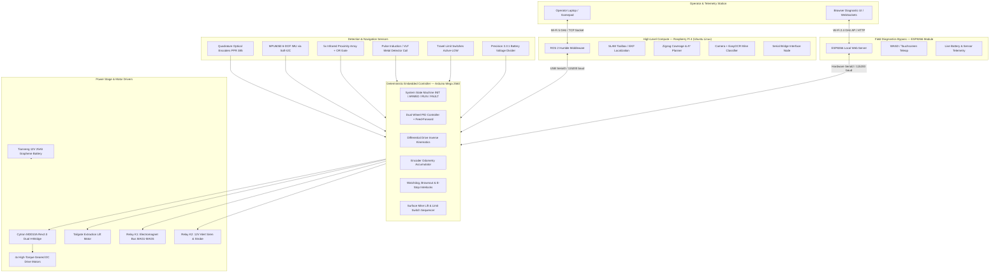

# Assiut Robotics — Minesweeper Autonomous Rover

<p align="center">
  
  
  
  
  
  
  
</p>

---

## 📌 Executive Summary

The **Assiut Robotics Minesweeper Rover** is an autonomous field robotics platform engineered for humanitarian mine action and robotics competitions (*Minesweeper International / Minesweeper Egypt*). The rover combines real-time computer vision, electromagnetic/inductive sensing, optical proximity scanning, autonomous coverage planning, closed-loop motion control, and surface mine extraction mechanics into an integrated cross-layer cyber-physical system.

- **Institution:** Faculty of Engineering, Assiut University
- **Team:** Assiut Robotics Team
- **Supervisor:** Eng. Sayed Khader
- **Demonstration Video:** [YouTube — Minesweeper Robot](https://youtu.be/dL5ubC7n4h4)

---

## 📖 Master Documentation Navigation Hub

This repository contains multi-tiered engineering documentation covering software, firmware, electronics, and competition field strategy. Use the quick links below to navigate to specific subsystems:

| Document | Description | Language | Primary Location |
| :--- | :--- | :---: | :--- |
| **Competition Overview & Technical Report** | Comprehensive engineering report, real-world bug troubleshooting, competition strategy, and mathematical models | Arabic | [`Minesweeper_Competitions_Overview.md`](./Minesweeper_Competitions_Overview.md) |
| **Electronic Circuit & Hardware Report** | Full PCB schematic analysis, power distribution rails, relay drivers, connectors, and BOM | English | [`Minesweeper2026/Files/Report/report.md`](./Minesweeper2026/Files/Report/report.md) |
| **ROS 2 Workspace Manual** | Simulation, SLAM Toolbox, Navigation, Zigzag Coverage, Vision OCR, and launch guides | English | [`rover_ws/README.md`](./rover_ws/README.md) |
| **Synchronized Pinout Map** | As-fabricated Mega 2560 pin mappings, timers, interrupts, and Soft-I2C flying leads | English | [`Minesweeper2026/Arduino/MotorController/Docs/Pinout.md`](./Minesweeper2026/Arduino/MotorController/Docs/Pinout.md) |
| **Firmware Architecture** | Object-oriented modular firmware breakdown, FSM state machines, and task loop timing | English | [`Minesweeper2026/Arduino/MotorController/Docs/Architecture.md`](./Minesweeper2026/Arduino/MotorController/Docs/Architecture.md) |
| **Serial Protocol & API** | Framing, command bytes, packet checksums, and telemetry stream formats | English | [`Minesweeper2026/Arduino/MotorController/Docs/Communication.md`](./Minesweeper2026/Arduino/MotorController/Docs/Communication.md) |
| **Motion Control & PID** | Kinematics, PID math, feed-forward, deadband thresholds, and odometry formulas | English | [`Minesweeper2026/Arduino/MotorController/Docs/MotionControl.md`](./Minesweeper2026/Arduino/MotorController/Docs/MotionControl.md) |
| **Safety & Watchdog Systems** | Communication timeouts, brownout protection, limit switch safety, and E-Stop states | English | [`Minesweeper2026/Arduino/MotorController/Docs/Safety.md`](./Minesweeper2026/Arduino/MotorController/Docs/Safety.md) |
| **Wiring & Harness Manual** | Wire gauges, connector specifications, terminal assignments, and crimping guide | English | [`Minesweeper2026/Arduino/MotorController/Docs/WiringManual.md`](./Minesweeper2026/Arduino/MotorController/Docs/WiringManual.md) |
| **Operator GUI & Telemetry** | PySide6 desktop dashboard, gamepad integration, and live telemetry viewer | English | [`Minesweeper2026/GUI/README.md`](./Minesweeper2026/GUI/README.md) |
| **Legacy 2024 Archive** | Historic codebase, design iterations, and legacy project records | English | [`Minesweeper2024/README.md`](./Minesweeper2024/README.md) |

---

## 🏛️ System Architecture

The robot utilizes a **hierarchical dual-interface architecture** providing robust separation of concerns between high-level computation, real-time deterministic control, and standalone field debugging:



---

## ⚙️ Technical Specifications

### Physical & Mechanical

- **Locomotion:** 4-Wheel Drive (4WD) with differential skid-steering
- **Chassis Dimensions:** Length 650 mm × Width 480 mm × Ground Clearance 85 mm
- **Wheel Specifications:** 220 mm diameter × 100 mm width rugged rubber tread
- **Track Gauge (Wheelbase):** $L = 150\text{ mm}$ (center-to-center lateral base)
- **Mine Extraction:** Motorized tailgate lift with active limit switch homing and 5× high-flux electromagnets

### Electrical & Power Distribution

- **Main Power Source:** Tianneng TNE12-25 12V 25Ah Deep-Cycle Graphene Lead-Acid Battery
- **Motor Driver:** Cytron MDD10A Rev2.0 (Dual Channel, 10A continuous / 30A peak per channel)
- **Power Rails:**
  - `12V_MAIN`: Motors, Cytron H-Bridge, and auxiliary power (Terminal `J24`, filtered with $2000\,\mu\text{F}$)
  - `12V_MG`: Dedicated electromagnet bus (Terminals `MAG1–MAG5`, filtered with $4000\,\mu\text{F}$)
  - `5V_LOGIC`: MCU logic, encoders, IMU, sensors (Terminal `J22`, filtered with $2000\,\mu\text{F}$)
  - `5V_SERVO`: Camera pan servo and auxiliary servos (Terminal `J23`/`J13`)
- **Total Bulk Decoupling Capacitance:** $> 11,000\,\mu\text{F}$ distributed to suppress inductive motor inrush

### Microcontroller & Sensors

- **Low-Level MCU:** Atmel ATmega2560 (16 MHz, 8 KB SRAM, 256 KB Flash)
- **Encoder Resolution:** 385 pulses per revolution (PPR) on output wheel shaft
- **Inertial Measurement Unit:** InvenSense MPU6050 (6-DOF Accelerometer + Gyroscope) via Soft-I2C on D31/D33
- **Surface Detection:** 5× Infrared optical proximity sensors (`APRX1–APRX5`) with hardware OR-gate aggregation
- **Subsurface Detection:** High-sensitivity inductive search coil (`J40`) for buried metallic mines

---

## 🚀 Quick Start Guide

### 1. Arduino Mega Firmware

1. Open [`Minesweeper2026/Arduino/MotorController/MotorController.ino`](./Minesweeper2026/Arduino/MotorController/MotorController.ino) in the Arduino IDE or VS Code / PlatformIO.
2. Select Board: **Arduino Mega 2560**, Processor: **ATmega2560**.
3. Verify feature flags in `Config.h`:

   ```cpp
   #define ENABLE_WATCHDOG        1
   #define ENABLE_ODOMETRY        1
   #define ENABLE_LIFT            1
   #define ENABLE_SENSORS         1
   #define USE_SOFT_I2C_FOR_IMU   1
   ```

4. Compile and flash to the Arduino Mega via USB.

### 2. Standalone ESP8266 Telemetry & Debugging Dashboard

1. Open [`Minesweeper2026/Arduino/WiFiController/`](./Minesweeper2026/Arduino/WiFiController/) in the Arduino IDE.
2. Connect an Arduino Uno with `RESET` tied to `GND` as a hardware bypass programmer (`TX` to `TX`, `RX` to `RX`).
3. Flash the code to the ESP8266.
4. Power the rover, connect your phone or laptop to the created Wi-Fi Access Point (`Minesweeper_Rover`), and browse to `http://192.168.4.1` for full manual control, battery monitoring, and telemetry.

### 3. ROS 2 Workspace (Ubuntu Linux with ROS 2 Humble)

Clone or navigate to the workspace, install system dependencies, and build:

```bash
cd rover_ws
rosdep update
rosdep install --from-paths src --ignore-src -r -y
colcon build --symlink-install
source install/setup.bash
```

#### Launching Gazebo Simulation

```bash
ros2 launch rover_bringup simulated_robot.launch.py
```

#### Launching on the Physical Robot

```bash
ros2 launch rover_bringup real_robot.launch.py
```

#### Running Joystick Teleoperation

```bash
ros2 launch rover_controller joystick_teleop.launch.py
```

---

## 📡 ROS 2 Topics & Interfaces

| Topic | Message Type | Description |
| :--- | :--- | :--- |
| `/cmd_vel` | `geometry_msgs/msg/Twist` | Target linear and angular velocity commands |
| `/odom` | `nav_msgs/msg/Odometry` | Wheel odometry fused with encoder ticks |
| `/imu/data` | `sensor_msgs/msg/Imu` | Filtered angular velocity and linear acceleration |
| `/joint_states` | `sensor_msgs/msg/JointState` | Rover wheel and lift joint positions |
| `/scan` | `sensor_msgs/msg/LaserScan` | 2D LiDAR range scan for obstacle avoidance |
| `/map` | `nav_msgs/msg/OccupancyGrid` | Live SLAM occupancy grid map |
| `/coverage_path` | `nav_msgs/msg/Path` | Zigzag lawnmower path generated by planner |
| `/mine_detected` | `rover_msgs/msg/MineAlert` | Detected mine payload (type: surface/buried, position: x, y) |

---

## 🛠️ Field Troubleshooting Matrix

Summary of the 12 verified physical hardware and firmware issues resolved during field testing (detailed root cause analysis available in [`Minesweeper_Competitions_Overview.md`](./Minesweeper_Competitions_Overview.md)):

| # | Symptom | Root Cause | Verified Resolution |
| :-: | :--- | :--- | :--- |
| **1** | Severe lagging & high loop latency | RTOS-like multi-tasking overload on ATmega2560 | Enabled compile-time feature flags in `Config.h` to disable unused modules |
| **2** | Motors deadlocked upon boot (`FAULT`) | Watchdog started counting before first command | Modified `Safety.cpp` to start timeout only after first valid command |
| **3** | Gripper stalled or moving violently | Floating limit pins + PWM set to 220 (86% power) | Activated `INPUT_PULLUP` and clamped `LIFT_PWM_SPEED` to 90 (35% power) |
| **4** | Limit switch dashboard inverted | Pins D51 and D53 swapped vs physical wiring | Swapped definitions in `Config.h` (`D51` = Bottom, `D53` = Top) |
| **5** | MPU6050 I²C bus deadlock | Shield copper wired ENC1 to D20/D21 (Hardware I²C) | Implemented Soft-I2C on D31/D33 with external flying leads |
| **6** | Alert siren continuously blaring | Driver circuit is Active-LOW via NPN transistor | Changed `#define SIREN_ACTIVE_HIGH 0` in `Config.h` |
| **7** | Inverted proximity readings | Hardware OR-gate output floating without threshold | Adjusted `PROXIMITY_THRESHOLD` to 500 and added calibration offsets |
| **8** | ESP8266 flashing timeout error | Arduino Mega serial passthrough dropped high-speed bytes | Used Arduino Uno hardware bypass (`RESET` to `GND`) for flashing |
| **9** | Rover stopping every 2s in web UI | Browser `keydown` only fired once; watchdog timed out | Implemented 100ms periodic retransmission loop in web frontend |
| **10** | ESP8266 unable to boot with divider | 10kΩ divider resistor placed adjacent to `EN`/`RST` pin | Isolated divider directly to ADC `A0` pin away from boot-strap lines |
| **11** | Electromagnet overheating | 100% duty cycle 12V applied continuously | Implemented 8s auto-off safety cutoff timer in firmware |
| **12** | ROS 2 motion jerky and unresponsive | Blocking serial read calls on main thread | Rewrote ROS serial bridge with non-blocking async threads at 20 Hz |

---

## 📋 Pre-Flight Commissioning Checklist

Before deploying the rover onto the competition field or test arena:

```markdown
1. Battery Health: Verify open-circuit voltage >= 12.6V (Do not operate below 11.8V).
2. Mechanical Fasteners: Inspect wheel hubs, motor brackets, and lift linkages for play.
3. Bench Motor Direction Check: Elevate chassis; command forward motion; verify both wheels spin forward.
4. Encoder Calibration: Rotate each wheel 1 full revolution by hand; verify ~385 counts accumulated.
5. Watchdog Fail-safe: Disconnect serial cable while motors run; verify complete motor shutdown within 1.5s.
6. Limit Switches: Manually depress top/bottom switches; confirm instantaneous lift motor deactivation.
7. Sensor Simulation: Pass metallic and surface mine samples; verify blue status LEDs illuminate and siren triggers.
8. Wire Harness Dress: Inspect Soft-I2C flying leads; ensure separation from high-current motor cables.
```

---

## 👥 Contributors & Team

- **Assiut Robotics Team — Faculty of Engineering, Assiut University**
- **Academic Supervisor:** Eng. Sayed Khader
- **Firmware, Controls & Hardware Review:** Control & Embedded Systems Engineering Sub-team

---

## 📄 License

This repository is released under the MIT License for educational, humanitarian demining research, and non-commercial competition purposes.
